<!--
SPDX-FileCopyrightText: 2026 Tazlin

SPDX-License-Identifier: AGPL-3.0-or-later
-->

<!-- Generated by gen_adr_index.py; edit the records, not this file. -->

# Decisions

One decision per record: what was chosen, what was rejected, and what it cost.

| Record | Status | Date |
| --- | --- | --- |
| [Record kudos movements as events; keep balances as projections](0001-event-sourced-kudos-accounting.md) | accepted | 2026-07-24 |
| [Separate currency postings from statistic postings](0002-separate-currency-and-statistic-event-tables.md) | accepted | 2026-07-24 |
| [Fold events with one database-serialized projector](0003-single-serialized-projector.md) | accepted | 2026-07-24 |
| [Admit spends under a payer lock against reserved availability](0004-payer-reservations-for-spend-admission.md) | accepted | 2026-07-24 |
| [Cut over through a temporary shadow mode](0005-shadow-mode-cutover.md) | accepted | 2026-07-24 |
| [Keep the archive permanent and repair only by compensation](0006-permanent-archive-compensation-only-repair.md) | accepted | 2026-07-24 |
| [Match each accounting table's foreign keys to its lifetime](0007-accounting-foreign-key-policy.md) | accepted | 2026-07-24 |
| [Promote users to trusted inside the projector](0008-trust-promotion-in-the-projector.md) | accepted | 2026-07-24 |
| [Balance every currency event against system accounts](0009-balanced-events-via-system-accounts.md) | proposed | 2026-07-25 |
| [Gate mode pins and transitions on an advisory lock](0010-advisory-lock-mode-gate.md) | accepted | 2026-07-25 |
| [Separate sampler trajectory, estimated work, and execution ceilings](0011-separate-sampler-trajectory-estimate-and-ceiling.md) | accepted | 2026-08-18 |
| [Publish versioned sampler contracts from one authoritative registry](0012-publish-versioned-sampler-contracts.md) | accepted | 2026-08-18 |
| [Treat image job TTL as a conservative prefetch lease](0013-image-job-ttl-is-a-prefetch-lease.md) | accepted | 2026-08-18 |
| [Quarantine deterministically invalid statistic events without stopping the projector](0014-quarantine-deterministically-invalid-statistic-events.md) | accepted | 2026-08-30 |
| [Decay moderation evidence in tiers under an anonymizing ceiling](0015-tiered-moderation-evidence-retention.md) | accepted | 2026-09-29 |
| [Protect koboldcpp instruct placeholders and publish the style contract](0017-protect-koboldcpp-placeholders-and-publish-the-style-contract.md) | accepted | 2026-09-13 |
| [Keep evidence text in object storage and bound rejection floods with countermeasures](0018-evidence-text-in-object-storage-behind-countermeasures.md) | accepted | 2026-09-30 |
| [Carry chat requests as a text request subtype](0019-chat-requests-as-a-text-request-subtype.md) | proposed | 2026-10-17 |
| [Select chat service behaviour through the request body and model id variants](0020-select-chat-service-by-request-body-and-model-variants.md) | proposed | 2026-10-17 |
| [Select chat service behaviour through base-URL service profiles](0021-select-chat-service-by-base-url-profiles.md) | proposed | 2026-10-17 |
| [Declare chat capabilities by pop fields alone](0022-declare-chat-capabilities-by-pop-fields.md) | proposed | 2026-10-17 |
| [Run the chat front as a separate ASGI process woken by a Redis signal](0023-run-the-chat-front-as-a-separate-asgi-process-woken-by-redis.md) | proposed | 2026-10-17 |
| [Stream chat deltas through a retained Redis stream per request](0024-stream-chat-deltas-through-a-retained-redis-stream.md) | proposed | 2026-10-17 |
| [Stream chat deltas through progress rows in Postgres](0025-stream-chat-deltas-through-postgres-progress-rows.md) | proposed | 2026-10-17 |
| [Classify client retries at the front and recover ambiguous submits by operation key](0026-classify-client-retries-and-recover-submits-by-operation-key.md) | proposed | 2026-10-17 |
| [Price chat generations by the text output estimate, with the basis isolated](0027-price-chat-generations-by-the-text-output-estimate.md) | proposed | 2026-10-17 |
| [Price chat generations on reported completion tokens](0028-price-chat-generations-on-reported-completion-tokens.md) | proposed | 2026-10-17 |
| [Route by declared parameter support and refuse unsupported values by default](0029-route-unsupported-parameters-by-declared-support-refusing-by-default.md) | proposed | 2026-10-17 |
| [Route by declared parameter support and drop unsupported sampling values by default](0030-route-unsupported-parameters-by-declared-support-ignoring-by-default.md) | proposed | 2026-10-17 |
| [Prefer the worker that last served a conversation's prefix](0031-prefer-the-worker-that-served-the-conversation-prefix.md) | proposed | 2026-10-17 |
| [Send chat images to workers as signed object storage URLs](0032-send-chat-images-to-workers-as-signed-urls.md) | proposed | 2026-10-17 |
| [Fill OpenAI sampling defaults server-side and map the developer role to system](0033-fill-openai-sampling-defaults-and-map-the-developer-role.md) | proposed | 2026-10-17 |
| [Map chat errors to the OpenAI envelope with OpenRouter's status vocabulary](0034-map-chat-errors-to-the-openai-envelope-with-openrouter-status-vocabulary.md) | proposed | 2026-10-17 |
| [Keep anonymous access on the chat front](0035-keep-anonymous-access-on-the-chat-front.md) | proposed | 2026-10-17 |

## Relationships

An edge points from a record to a record it references.

```mermaid
flowchart TD
    r0001["0001: Record kudos movements as events; kee…"]
    r0002["0002: Separate currency postings from stati…"]
    r0003["0003: Fold events with one database-seriali…"]
    r0004["0004: Admit spends under a payer lock again…"]
    r0005["0005: Cut over through a temporary shadow m…"]
    r0006["0006: Keep the archive permanent and repair…"]
    r0007["0007: Match each accounting table's foreign…"]
    r0008["0008: Promote users to trusted inside the p…"]
    r0009["0009: Balance every currency event against…"]
    r0010["0010: Gate mode pins and transitions on an…"]
    r0011["0011: Separate sampler trajectory, estimate…"]
    r0012["0012: Publish versioned sampler contracts f…"]
    r0013["0013: Treat image job TTL as a conservative…"]
    r0014["0014: Quarantine deterministically invalid…"]
    r0015["0015: Decay moderation evidence in tiers un…"]
    r0017["0017: Protect koboldcpp instruct placeholde…"]
    r0018["0018: Keep evidence text in object storage…"]
    r0019["0019: Carry chat requests as a text request…"]
    r0020["0020: Select chat service behaviour through…"]
    r0021["0021: Select chat service behaviour through…"]
    r0022["0022: Declare chat capabilities by pop fiel…"]
    r0023["0023: Run the chat front as a separate ASGI…"]
    r0024["0024: Stream chat deltas through a retained…"]
    r0025["0025: Stream chat deltas through progress r…"]
    r0026["0026: Classify client retries at the front…"]
    r0027["0027: Price chat generations by the text ou…"]
    r0028["0028: Price chat generations on reported co…"]
    r0029["0029: Route by declared parameter support a…"]
    r0030["0030: Route by declared parameter support a…"]
    r0031["0031: Prefer the worker that last served a…"]
    r0032["0032: Send chat images to workers as signed…"]
    r0033["0033: Fill OpenAI sampling defaults server-…"]
    r0034["0034: Map chat errors to the OpenAI envelop…"]
    r0035["0035: Keep anonymous access on the chat fro…"]
    r0001 --> r0003
    r0001 --> r0004
    r0001 --> r0005
    r0001 --> r0006
    r0002 --> r0006
    r0002 --> r0007
    r0003 --> r0001
    r0003 --> r0005
    r0003 --> r0014
    r0004 --> r0001
    r0004 --> r0003
    r0005 --> r0003
    r0005 --> r0008
    r0005 --> r0010
    r0006 --> r0005
    r0007 --> r0002
    r0007 --> r0014
    r0008 --> r0003
    r0008 --> r0005
    r0008 --> r0006
    r0010 --> r0005
    r0012 --> r0011
    r0013 --> r0011
    r0014 --> r0003
    r0014 --> r0007
    r0017 --> r0012
    r0018 --> r0015
    r0020 --> r0021
    r0021 --> r0020
    r0024 --> r0025
    r0025 --> r0023
    r0025 --> r0024
    r0027 --> r0028
    r0028 --> r0027
    r0029 --> r0030
    r0030 --> r0029
```

