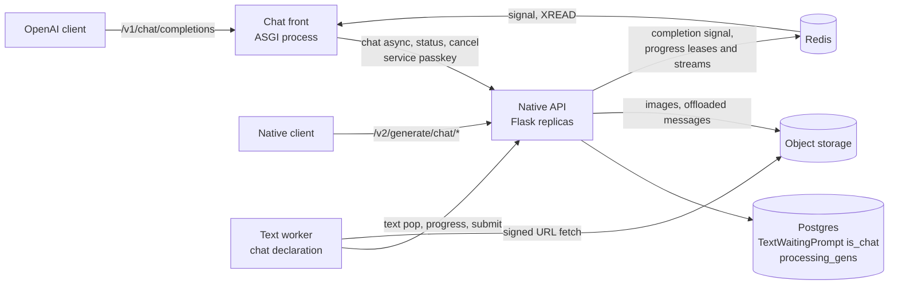
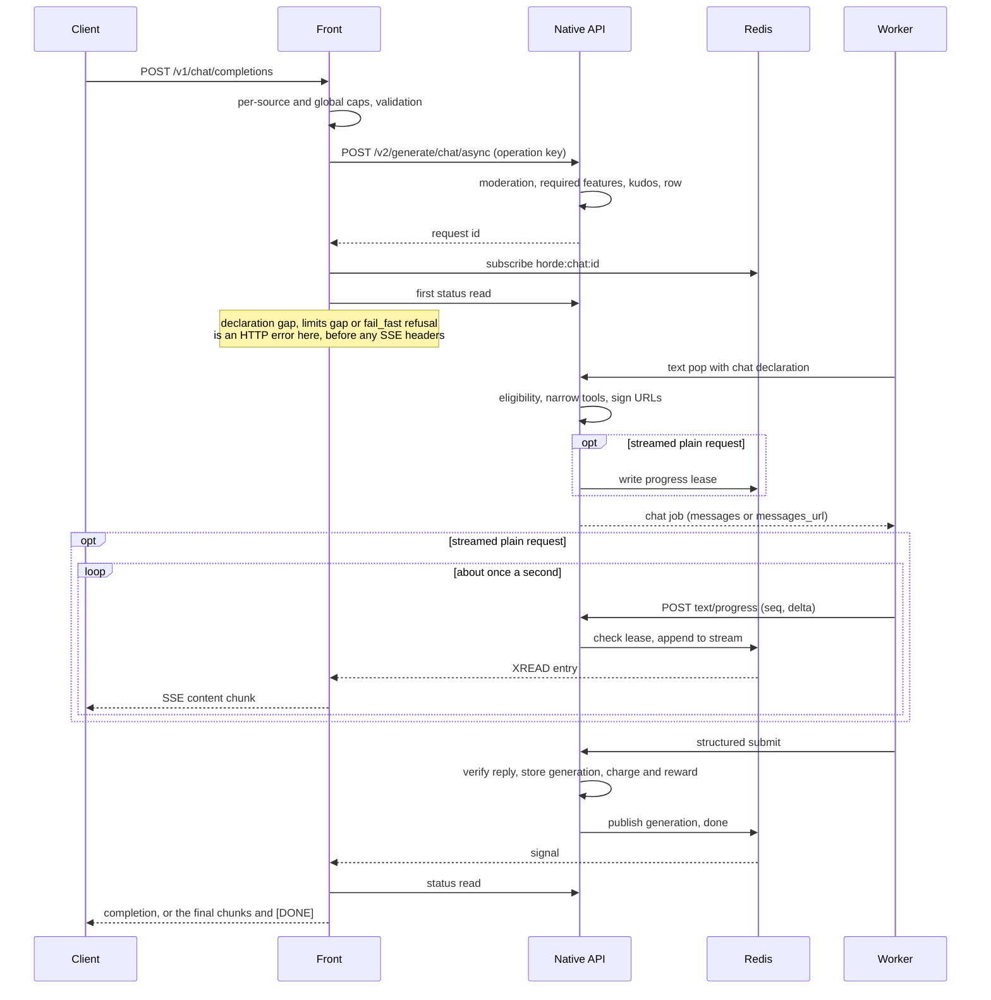
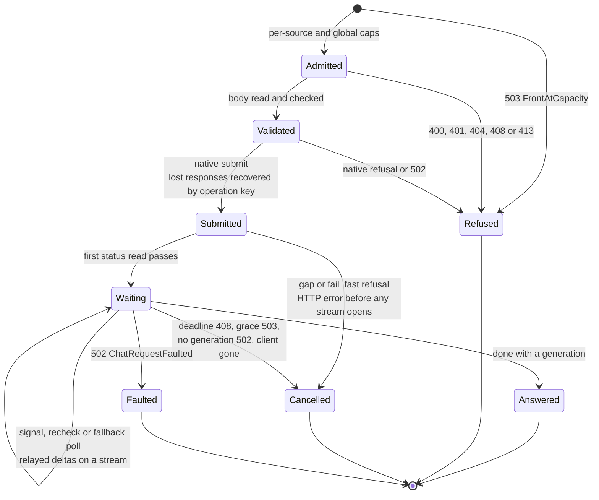
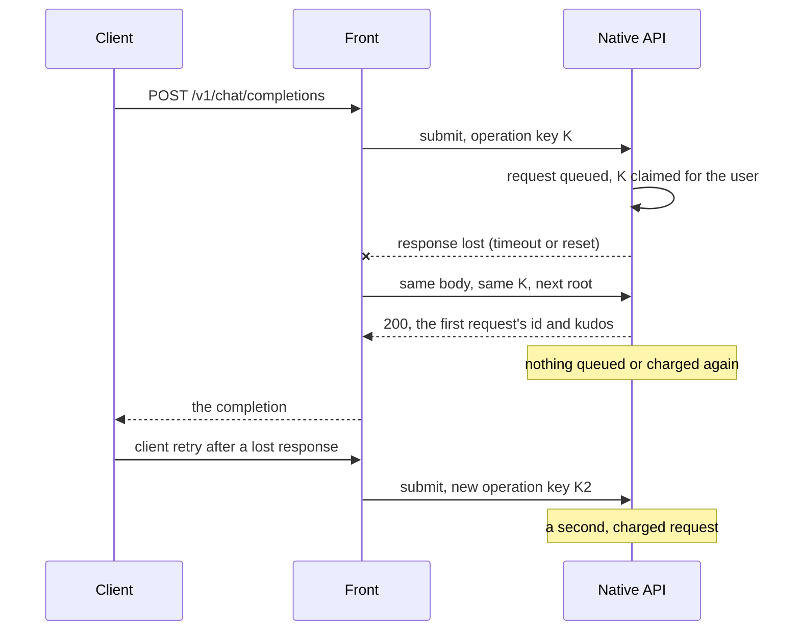
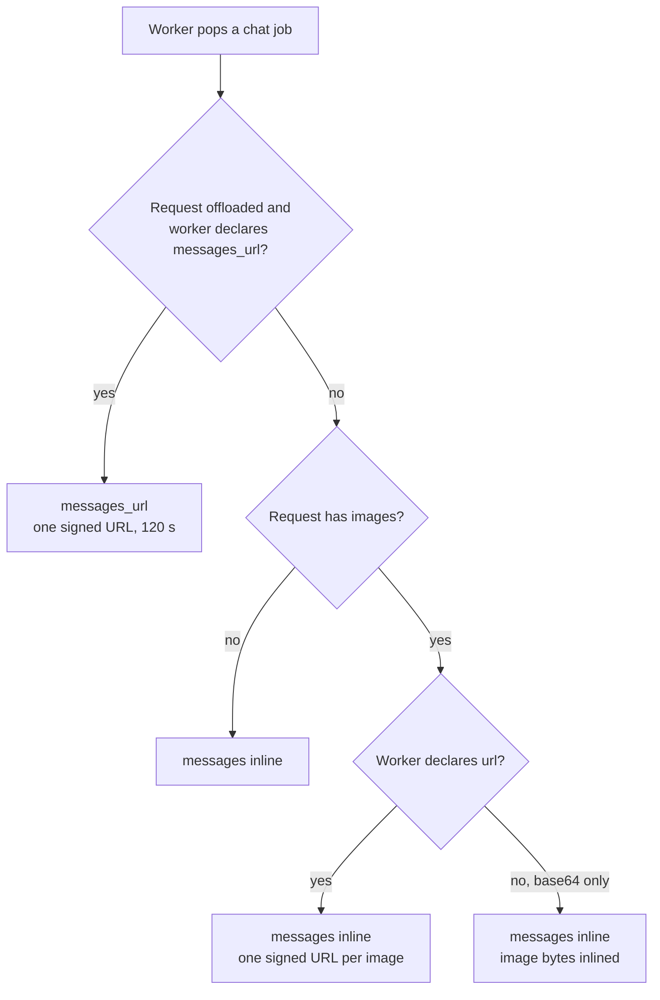
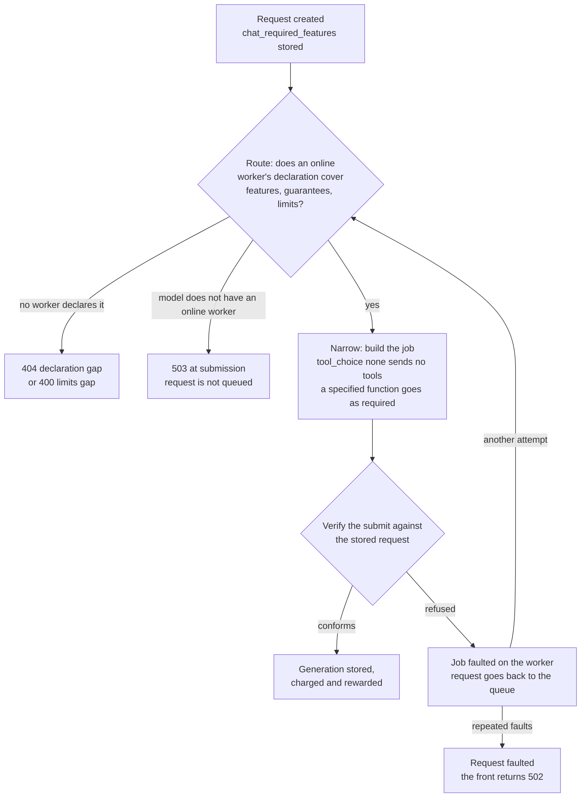
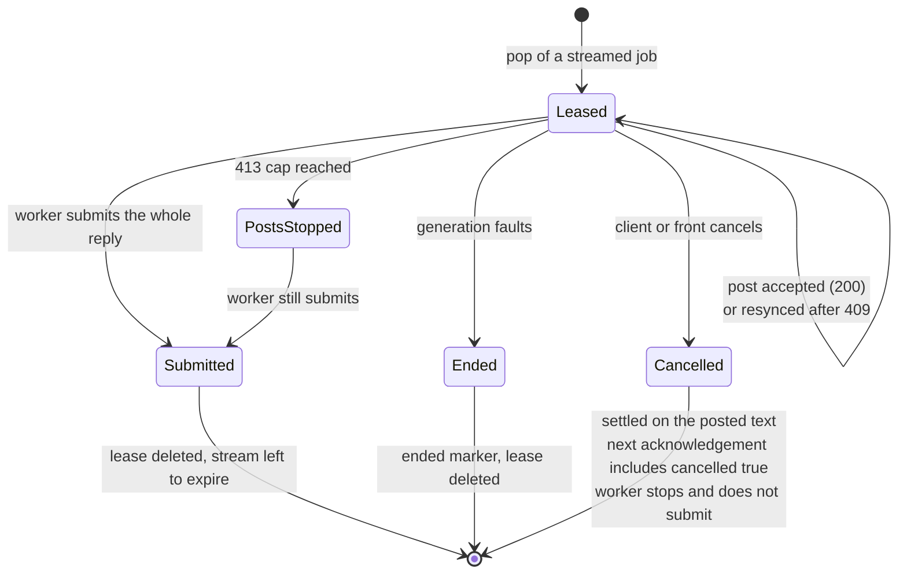

<!--
SPDX-FileCopyrightText: 2026 Tazlin

SPDX-License-Identifier: AGPL-3.0-or-later
-->

# Chat requests on the Horde

<!-- BEGIN GENERATED: topics (gen_doc_index.py) -->
Topics: [chat](../topics.md#chat), [requests](../topics.md#requests), [workers](../topics.md#workers)
<!-- END GENERATED: topics -->

- A chat request sends an OpenAI `messages` array to a worker. The worker renders the conversation with the loaded
  model's chat template. Chat requests share the text queue, pricing and limits.
- Workers opt in on every text pop. The Horde routes chat requests by the declared model, limits and required features.
- A separate OpenAI-compatible front serves `/v1/chat/completions` through the native chat routes. Redis signals
  notify the front when a reply is available.
- Unsupported parameters are refused, and the error message includes the key. Unknown keys inside messages, tool
  definitions and `tool_choice` are dropped, as OpenAI does.
- Plain streamed requests receive text as the worker posts progress. Other requests receive the complete reply
  after generation. Each request produces one choice.

The sections cover storage and request lifetime, worker declarations and conformance, client compatibility,
admission and cost, and reply delivery. The linked ADRs record the rationale and rejected alternatives.
Use the [chat requests reference](../reference/chat_requests.md) for native and worker contracts and the
[chat front reference](../reference/chat_front.md) for OpenAI-compatible requests and responses.

## Prompt strings and model templates {#the-problem-one-prompt-string-for-many-templates}

A native text request contains one prompt string, which the worker sends to the model as written. Instruction-tuned
models give good replies only when the conversation is rendered in the chat template used to train them, with that
model's role markers and turn separators. The client has to render the prompt with the correct template for the
serving model and backend. An incorrect template can lower reply quality without producing an error.

With a structured conversation, the worker renders the input with the loaded model's template. The request can also
include tool definitions, tool results and images as separate fields. Using OpenAI's chat-completions format lets
existing clients send these requests without translating them into a Horde-specific format.

Translating the conversation into a prompt string when it is submitted would avoid changing the native API. However,
the Horde would then have to maintain every model's chat template. The text request format also lacks separate fields
for tools and images, and cannot return the backend's reported usage
([ADR 0019](../decisions/0019-chat-requests-as-a-text-request-subtype.md)).

## How a chat request travels

A request passes through the front, the native API and a volunteer worker, with Postgres, Redis and object storage
between them. The front does not hold a database connection. It returns results from the native status route or,
while a stream is open, from the retained progress stream.

The sequence below shows one request. The `opt` blocks apply only to streamed requests without tools or structured
output. The loop runs only when the worker posts progress. Other requests use the final status.

The front submits over HTTP and subscribes to the request's completion signal. When the signal arrives, the front
reads the status once and returns an OpenAI response. A native client can call the chat routes directly and poll the
status route.

## Design choices

The design separates request storage and lifetime from worker eligibility, client compatibility and reply delivery.

### Storage and request lifetime

#### Chat as a text request subtype

A chat request is a `TextWaitingPrompt` with a `messages` column and an `is_chat` discriminator
([ADR 0019](../decisions/0019-chat-requests-as-a-text-request-subtype.md)). Queue position, kudos, upfront kudos,
concurrency limits, statistics, countermeasures and moderation apply because the code that applies them to text
requests runs unchanged. The discriminator keeps the route families apart. A chat id is not found on the text routes,
and a text id is not found on the chat routes.

Reusing the text request class means storing the conversation in two forms. The worker receives structured messages,
while token estimates, kudos calculations and moderation use a flattened string in the row's `prompt` column.
Validation changes must be reflected in both forms. A separate chat class and table would avoid this duplication,
but would require separate handling wherever text request behaviour also applies to chat
([Flattened prompt](../reference/chat_requests.md#flattened-prompt)).

#### A separate front woken by Redis

An OpenAI call keeps its connection open until the reply is ready, and a horde request can wait minutes for a worker
within its [20-minute request lifetime](../reference/service_limits.md#request-lifetime-and-expiry).
Waiting inside the Flask application would hold one Waitress thread for each open call, leaving fewer threads for
worker pops and submits. The front therefore runs as a separate ASGI process, where each waiting call uses a coroutine
([ADR 0023](../decisions/0023-run-the-chat-front-as-a-separate-asgi-process-woken-by-redis.md)). The front does not
hold a database connection. The outcome is stored in Postgres, and the front reads it through the status route.

Assignment and settlement can refresh that lifetime. The chat front's
[HTTP response budgets](../reference/service_limits.md#chat-front-deadlines-and-admission) are separate and can end
the client's wait sooner.

The native side publishes a small event on `horde:chat:<request id>` when a generation is stored and when a request
ends ([Completion signal](../reference/chat_requests.md#completion-signal)). These notifications do not contain the
reply text. If a notification is lost, the front retrieves the same result on its next fallback poll. Polling alone
would also work, but would increase status traffic as more clients wait for replies.

A request on the front moves through the states below. After submission, any exit other than a completed reply or
a fault cancels the Horde request. Abandoned requests therefore leave the queue
([Errors the front returns](../reference/chat_front.md#errors-the-front-returns)):

Once a request reaches `Submitted`, every error from the front includes `x-should-retry: false`, since a retry would
be a second charged request. The front repeats a call on its own in one case only, a submit whose response was lost.
It sends the identical body with the same operation key, and the Horde returns the existing request
([ADR 0026](../decisions/0026-classify-client-retries-and-recover-submits-by-operation-key.md)):

Each new client request gets a new operation key. Recovery therefore applies only when the front repeats its native
submission. A retry from the client creates a separate request.

Running a separate front adds a process to operate. Each open client connection belongs to the front process that
accepted it. If that process crashes, the submitted Horde requests continue running and incur charges, but their
replies do not reach the clients.

#### Images by the declared transport

The horde fetches, checks and normalises each image at submit, stores it as JPEG, and keeps only a reference in the
row ([Images](../reference/chat_requests.md#images)). At pop, after the commits that release the queue's row lock,
the horde sends the images by the worker's declared transport
([ADR 0032](../decisions/0032-send-chat-images-to-workers-as-signed-urls.md)). A worker that declares `url` receives
a signed download URL per image and fetches it. A worker that declares only `base64` receives the bytes inline.

The alternative was to read the images from object storage under the row lock and inline them as base64. That puts a
network read inside the lock and megabytes in a JSON response. The `base64` transport reads from the store after the
lock is released. Storing base64 in the row would load image bytes on every queue scan. With URLs, the worker must be
able to reach object storage, and a failed fetch faults the job.

A deployment can also offload a whole large request. At submit, the messages are stored as one JSON object with the
images inlined. A worker that declares `messages_url` receives one short-lived signed URL in place of `messages`
([Messages offload](../reference/chat_requests.md#messages-offload)). The worker then makes one self-contained fetch
and does not have to manage partial downloads. Large bodies also stay out of the pop response. The transport is
chosen for each generation, based on what the request stored and what the popping worker declared:

### Worker declarations and conformance

#### Capability declaration and routing by features

On every text pop, a worker declares what it serves: `chat_jobs`, the `model_id`, `chat_limits`, `chat_features` and
`image_transports` ([ADR 0022](../decisions/0022-declare-chat-capabilities-by-pop-fields.md)). A capability depends on
the loaded model and backend. For image inputs, a projector is the model component that maps image features
into the language model's input.
Capabilities include whether that projector is loaded, whether the template renders tools, and how
much context the backend really has.

A bridge version string cannot express these, so the version table used by the
horde for image features cannot be used for chat. The horde does not probe workers. Server-side probes would turn
claims into evidence, but they would cost worker time before any job.

Request requirements are computed once. When a request is created, `required_chat_features` derives its required
features and stores them on the row. A field at its documented default counts as absent. The eligibility check
compares the worker's declaration with that stored list and does not load a candidate's messages
([Eligibility](../reference/chat_requests.md#eligibility)).

This keeps existing workers compatible. A worker that predates chat does not send `chat_jobs`, so it does not receive
a job without a prompt. A worker that declares chat keeps receiving text jobs under its text limits, so opting in does not take text
work away. A chat-only worker sets `prompt_jobs: false`. Routing relies on these declarations being accurate, so a
misconfigured worker can receive jobs with requirements that it cannot meet.

#### Guarantees and the conformance mode

A backend can accept every field and still deviate from the contract on purpose. For example, it may render the same
prompt for every `tool_choice`, clamp the temperature when tools are present, or trim a prompt that does not fit. Each
is a reasonable choice for a local backend, but over the horde the requester sees only the reply.

A capability means that the worker acts on an input. A guarantee means that the reply follows that part of the
contract exactly
([ADR 0036](../decisions/0036-route-chat-requests-by-declared-guarantees-under-a-conformance-mode.md)).

Capabilities and guarantees share the `chat_features` list. A numeric limit such as `tools_max_temperature` goes in `chat_limits`.

A request is `strict` unless its `horde` object selects `best_effort`. These are
[conformance modes](../how-to/send_chat_completions.md#conformance): they determine which worker guarantees the
request requires. Strict is the default because plain OpenAI
clients cannot opt in, and they are written for OpenAI behaviour. Under `strict`, `required_chat_features` adds the
required guarantees to the stored list, so the eligibility check compares them in the same way as features. Under
`best_effort` the request does not require any guarantee. Limits apply in both modes, since a clamped value changes
the request. The mode controls only how closely the reply follows the request.

The contract is enforced at routing, dispatch and submission. Routing sends a request only to a worker whose
declaration covers it. Dispatch narrows the job's contents where the contract allows. Under `tool_choice: none` the
worker does not receive tool definitions, so `none` does not need a guarantee. A `tool_choice` that specifies a
function reaches the worker as that one function under `required`. The stored request keeps the client's values.
At submit, verification checks the detectable properties of the
reply against those stored values; it cannot verify hidden backend behavior.

Reply verification rejects detectable contract violations even when the worker declares the required guarantees.
It can only check properties that are visible in the submitted payload.

Verification rejects replies that a client cannot use, such as calls to functions outside its tools or duplicate
call IDs. Strict conformance also checks the requested tool choice and structured output. The exact
[reply verification rules](../reference/chat_requests.md#reply-verification) belong to the native submit contract.
A refused submit leaves the job pending for the worker to fault; faulted jobs count toward the request's fault limit.
A trimmed prompt or a hidden tool-selection pass does not show in the reply and is not verified.

#### Prompt fit on the worker

Under the guarantee `prompt_overflow_refused`, a worker faults a conversation that does not fit and does not trim it.
Only the worker can keep this guarantee. The horde does not run a tokenizer. It sizes context at 3 characters per
token (`CHARS_PER_TOKEN_ESTIMATE` in `horde/classes/kobold/request_fit.py`), and a trimmed prompt does not show in the
reply. The worker's token count has to be at least the count used by generation. With a lower count, a prompt can
pass the fit check and still overflow, and the backend then trims it.

An exact counter renders the conversation with the backend's template and tokenizes it. Its count matches the count
used by generation when both render with the same template and the same BOS token. When they differ, the counter's
count is too low. The minimal worker in `tools/chat_worker_example/` therefore compares its counter with the
backend's `usage.prompt_tokens` for one probe conversation at startup. It declares the guarantee only when the
counter's count is not lower than the backend's.

A backend without a counter route can still back the guarantee with an upper bound. Each token from a byte-level BPE
tokenizer covers at least one UTF-8 byte, so the byte length of the messages' JSON is an upper bound on the token
count of the message text. The JSON keys around each message stand in for its role markup.

The template's fixed part is the BOS token, any system prompt injected by the template, and the generation prompt.
The worker measures it once from the probe's `usage.prompt_tokens` and adds it to the bound. The probe does not
include tools, so the tool preamble is not measured. For tool requests, the bound backs the guarantee only when the
operator adds the preamble's size with `--template-overhead`.

This conservative count reduces the usable context. It counts one token per byte, about three times the Horde's
estimate of 3 characters per token for ASCII text, and more for text outside ASCII. The Horde assigns conversations that fit
by the horde's estimate, so a worker that uses the byte bound faults long conversations with `prompt_overflow`.

A worker that aborts more than 20 jobs in an hour is put into maintenance. The alternative is to trim the prompt.
Trimming keeps the job but breaks the guarantee, so a worker that trims does not declare the guarantee and serves only
`best_effort` requests. The counters and the check script are in
[Write a minimal chat worker](../how-to/write_a_minimal_chat_worker.md#fit-check-and-the-overflow-guarantee).

### Client compatibility and access

#### Strict handling of unsupported parameters

A key or value that is not implemented is refused with `400 UnsupportedChatParameter`, and the message includes the
key ([ADR 0029](../decisions/0029-route-unsupported-parameters-by-declared-support-refusing-by-default.md)). A field
at its documented default counts as omitted, so stock clients that send defaults unprompted still work. The front also
drops a short, fixed list of default no-ops. Capability fields (`tools`, `response_format`, image parts) are not
dropped, since they change the result.

Worker availability is checked separately, and each cause has its own refusal
([What a client can rely on](#what-a-client-can-rely-on)).

The native route and front share request-shape validation in `horde/chat_contract.py`. Matching OpenAI's
messages and parameter paths lets clients diagnose the same malformed tool history or schema on either service.
Optional `horde.openai_guards` adds backend-specific checks, such as requiring a mention of JSON for `json_object`.
See [Value and contract validation](../reference/chat_front.md#value-and-contract-validation) for the rules.

Nested message and tool objects tolerate unknown keys so clients can replay SDK-generated replies, including
SDK-specific fields, through a tool loop. Top-level request options remain subject to screening. The
[parameter screening contract](../reference/chat_front.md#parameter-screening) specifies which objects drop keys
and which refuse them.

The alternative was to drop unsupported fields by default, as OpenRouter does
([ADR 0030](../decisions/0030-route-unsupported-parameters-by-declared-support-ignoring-by-default.md)). That produces
fewer errors, but the change to the reply is then reported only in a field that most clients do not read.

Clients have to stop sending unsupported fields. A value that is a no-op at its default can be added to the front's
default table by key, as a deliberate change.

#### Sampling defaults and the developer role

Every chat payload includes every sampling field, with OpenAI's default where the client left one out
([ADR 0033](../decisions/0033-fill-openai-sampling-defaults-and-map-the-developer-role.md)). An omitted field then
means the same thing on every worker. A worker's local defaults would not give that consistency (koboldcpp's defaults
include a repetition penalty). The cost is that an operator's tuned defaults do not apply to chat jobs.

A `developer` message is stored and sent as `system`, so templates that predate the role can render it. The rewrite
loses the developer role's precedence over `system`. While the rewrite is in place, the horde does not advertise a
developer-role feature.

#### Reasoning

A reasoning model generates reasoning before the answer. The worker submits it in `reasoning_content`, separate from
`content`. A client that does not handle reasoning then receives a clean answer, and a reasoning block cut off by
`max_tokens` cannot become the reply. The front returns the reasoning as `reasoning_content`, so a client that reads
that field can show progress while the model generates reasoning. A request that sets `horde.include_reasoning` to
false does not receive the reasoning. The native status shows it in both cases. See the native [reasoning contract](../reference/chat_requests.md#reasoning)
for storage and charging details.

Reasoning is generated output, and OpenAI bills it as completion tokens. Its characters are therefore counted with the
content and tool calls, up to the requested `max_length`. A reply that spent its whole budget on reasoning is charged
and rewarded for that budget. The same count is the worker's speed sample. The worker's `reasoning_tokens` count is
shown but does not change the charge, as with every other reported count
([Reasoning](../reference/chat_requests.md#reasoning)).

Reasoning and the answer share `max_tokens`, and the OpenAI API cannot resume reasoning. A reply cut off while
thinking cannot be continued. In a follow-up request, the earlier reasoning is only a previous turn. The thinking and
the answer therefore have to fit in one request.

When `reasoning_effort` is absent, koboldcpp gives the model an unlimited thinking budget, so a small `max_tokens`
could be spent on reasoning alone. For that reason, when the client omits the value, a worker that declares the
feature receives `medium`, OpenAI's default
([ADR 0033](../decisions/0033-fill-openai-sampling-defaults-and-map-the-developer-role.md)). On koboldcpp that caps
the thinking at about half of `max_tokens`. The default makes an empty reply less likely but does not guarantee an
answer.

#### Errors in the OpenAI envelope

The front returns every error as `{"error": {"message", "type", "param", "code", "metadata"}}`, with the horde's
return code as `code`. Where OpenAI does not define a status, the front uses OpenRouter's status vocabulary, such as
502 for a worker or generation failure and 503 for no eligible worker
([ADR 0034](../decisions/0034-map-chat-errors-to-the-openai-envelope-with-openrouter-status-vocabulary.md)). If errors
were mapped onto only 400 and 500, capacity failures could not be told apart from server faults.

After a stream's headers are sent, the status cannot change. A later error therefore arrives as one SSE event that
holds the envelope and does not include a choice. The front does not make up a finish reason. The full table is in
[Errors the front returns](../reference/chat_front.md#errors-the-front-returns).

#### Anonymous access

A request without `Authorization` uses the anonymous key, as the native API allows ([ADR
0035](../decisions/0035-keep-anonymous-access-on-the-chat-front.md)). Anonymous access lets people use the service
without registering. Requiring a key would remove that access. Abuse is limited by the existing anonymous limits, the
lowest kudos priority, and per-source caps on the front. The per-source caps count all users behind one address
together.

#### Service selection

Horde options that do not have an OpenAI key (worker restrictions, trusted or validated workers, context sizing) go
in a `horde` object in the request body. Clients send it through the SDK's extra body fields
([ADR 0020](../decisions/0020-select-chat-service-by-request-body-and-model-variants.md)). A request may list
acceptable models in `models` in place of `model`. Any listed model may serve the request, and the response reports
which model generated the reply. The list states which models the client accepts, so reordering the list does not
change the operation fingerprint. If any entry is unknown, the whole request is rejected.

Under `context_fit: truncate_oldest`, a history too long for any served context loses its oldest whole turns. Every
system and developer message and the latest user turn are kept. Moderation screens the full submitted messages before
any message is dropped. For the request's lifetime, its row stores the kept messages, which the worker receives. As on
every request, the row also stores the full flattened submission in `submitted_prompt`.

The model id is the exact native model name. The front reserves the colon, so a model id that contains a colon is
refused as unknown with 404 `model_not_found`.

The alternative was base-URL profiles
([ADR 0021](../decisions/0021-select-chat-service-by-base-url-profiles.md)), with one configuration per application.
They would need a resolver and a revision store. Model pickers would not show them, and clients that hardcode `/v1`
would lose them.

### Admission and cost

#### Admission against the online pool

Workers are volunteers, and the set of models online changes from minute to minute. By default a request waits for a
worker for the front's whole budget. A client that would rather fail early sets
`horde.availability_mode: "fail_fast"`, and the front then checks the first status read. If there are zero eligible
worker threads, or the `wait_time` is over the remaining budget, the front refuses the request with 503
`queue_unavailable` and a `Retry-After`, and cancels it. The refusal reflects the pool at that moment, and the client
decides whether to retry. The same request may be served once workers come online.

The wait estimate counts the queued work ahead of the request that its eligible workers could take, and divides it by
their throughput
([Queue position and wait time](request_feasibility_and_queue_pressure.md#queue-position-and-wait-time)). It is an
approximation, so a request may still start sooner or wait longer.

A refusal at the first read arrives as a plain HTTP error before a stream opens. A streaming client can handle it like
any other refused request. The front waits up to about 2 seconds for a status that includes queue information before
it decides. A request that was just submitted is not in the horde's cached queue positions until they refresh
([No eligible worker](../reference/chat_front.md#no-eligible-worker)).

#### Pricing by the text output estimate

A chat generation is charged and rewarded through the text formula. The token count is the number of characters in
the reply (content, reasoning, and each tool call's name and arguments) divided by four, with a floor of 20 tokens and
a cap at the requested `max_length`
([ADR 0027](../decisions/0027-price-chat-generations-by-the-text-output-estimate.md),
[Pricing](../reference/chat_requests.md#pricing)). A short reply to a large `max_tokens` is charged for the short
reply. The basis is computed in one function and stored on every generation as `charge_basis: output_estimate`.

When the client cancels a streamed generation, it is settled on the same basis, using the content posted by the
worker before the cancel. The Horde measured that content, so the volunteer worker is paid for the work it delivered.

The alternative was pricing on the token counts reported by workers
([ADR 0028](../decisions/0028-price-chat-generations-on-reported-completion-tokens.md)). That is fairer per reply, but
it trusts volunteer reports that are not audited, which would give workers a reason to over-report. The reported
counts are stored and shown on every generation but are not part of the charge, so the alternative can be evaluated on
real data. The character-based estimate is less accurate for code and non-English text,
and the floor charges a near-empty reply as 20 tokens.

A client can cap the cost of a request with `horde.max_kudos`. The native route compares it with the dry-run quote,
which assumes the full `max_length`, and refuses the request before anything is queued, held or uploaded. The actual
charge follows the reply's output estimate, which is usually smaller. The check is therefore conservative, and a
refused request might have cost less ([Kudos cap](../reference/chat_front.md#kudos-cap)).

### Reply delivery

#### Streaming

A streamed request without tools, whose `response_format` is absent or `text`, receives its content as the worker
posts progress, about one post a second. The front spreads the text of each post evenly over the estimated interval
until the next post, so the client sees a steady flow of text. Without pacing, each post would arrive as one lump.
Pacing adds up to about one post interval of latency. More frequent worker posts would cost the Horde more progress
writes.

The batches are kept in one retained Redis stream per request. Redis avoids progress writes to the primary database,
but progress can be lost on failover
([ADR 0024](../decisions/0024-stream-chat-deltas-through-a-retained-redis-stream.md)). The alternative was Postgres
progress rows. They are durable, but they cost primary database writes on the connection pool shared by pops and
submits ([ADR 0025](../decisions/0025-stream-chat-deltas-through-postgres-progress-rows.md)).

A lease in Redis, written at pop, authenticates a generation's posts, so the progress route does not read Postgres.
The lease lasts as long as the streamed generation does from the worker's point of view
([Streaming progress](../reference/chat_requests.md#streaming-progress)):

A cancel settles the generation on the content that the worker posted before the cancel. The worker is paid for that
text, and the requester is charged for it. The settlement does not record a dropped job, so a worker that stops on the
`cancelled` flag is not penalised for a client leaving. The front relays entries as they arrive and checks them
against the final reply. If the reply equals or extends the relayed text, the stream completes. If the reply diverges,
the stream ends with an error event.

A request with tools or a non-text `response_format` waits for the whole reply, as a non-streamed request does. The
front then sends the completed reply as server-sent events. Buffering lets it validate tool calls and structured
output before exposing them to the client. The [response reference](../reference/chat_front.md#buffered-stream-events)
specifies event order and fields.

## What a client can rely on

- **Identity.** A completion's `id` is `chatcmpl-` plus the Horde request id, and `x_horde.request_id` holds the id
  alone. Use it for support or a native status read.
- **Charges.** A request costs what the same reply would cost as a text request, reported in `x_horde.kudos` with its
  `charge_basis`. Reported token counts do not change it. A lost submit inside the front is recovered by operation key
  without a second charge ([ADR 0026](../decisions/0026-classify-client-retries-and-recover-submits-by-operation-key.md)).
  A retry by the client is a new request and can create another charge.
- **Request handling.** Required features are checked against worker declarations. Unsupported parameters are
  refused. Under `strict`, a reply's tool calls follow `tool_choice` and `parallel_tool_calls`, and its content follows
  `response_format`, whatever the worker declared.
- **Stream order.** A stream follows the [response event order](../reference/chat_front.md#buffered-stream-events), and an error after the headers arrives as one error
  event followed by `[DONE]`.
- **Retry control.** Once the Horde may hold a request, errors include `x-should-retry: false`, so SDKs do not
  retry automatically. A later client retry can create a second charged job.
- **Failure behaviour.** A worker that cannot serve a job faults it, and the job returns to the queue until the
  request's fault limit is exceeded. A faulted request gets 502.

Availability separates support from capacity: a worker can declare every required feature while remaining busy.
The Horde can lower the requested output limit to fit the online workers' declarations. This does not reserve a
worker or guarantee assignment. The [availability reference](../reference/chat_front.md#no-eligible-worker)
specifies refusal precedence, timing and cancellation; [context adjustments](../reference/chat_requests.md#context-adjustments)
specifies output-limit changes.

## What a client cannot rely on

- **Delta streaming.** It covers plain text requests only. A request with tools or structured output streams the reply
  whole after generation. A relayed stream is best effort, since a request with a lost stream still ends with the full
  reply.
- **Multiple choices.** `n` other than 1 is refused.
- **Worker selection by quantisation or pinned model.** `horde.quantizations` and `horde.pinned_model` are unknown
  keys and get `400 UnsupportedChatParameter`.
- **Identical answers across workers.** The defaults are the same everywhere. Backends, quantisations and templates
  are not.
- **Verified capabilities.** A worker that declares a feature is trusted to honour it, and the declaration is not
  verified. Only what shows in the reply is checked. A trimmed prompt or a clamped sampler is not checked.
- **Token counts.** Native status returns the worker's reported counts, or null for missing counts. The front
  estimates missing counts and marks them with `x_horde.estimated_usage`.

## Related

- [Chat requests reference](../reference/chat_requests.md): routes, body, pop declaration, payload, submit, pricing
  and signals.
- [Chat front reference](../reference/chat_front.md): the front's request keys, response shape and metrics.
- [Serve chat jobs from a text worker](../how-to/serve_chat_jobs.md): the worker procedure.
- [Send chat completions through the OpenAI-compatible front](../how-to/send_chat_completions.md): the client
  procedure.
- [Request feasibility and queue pressure](request_feasibility_and_queue_pressure.md): how `is_possible` and the
  queue fields behave, for chat requests as for text.
