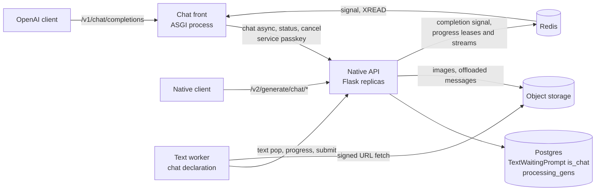
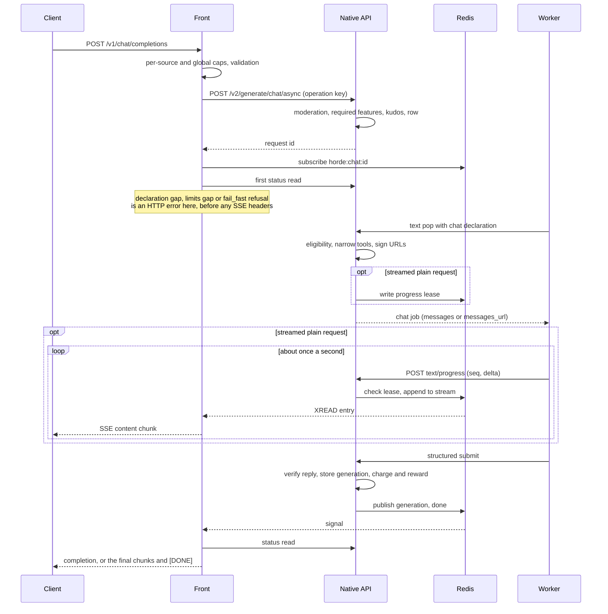
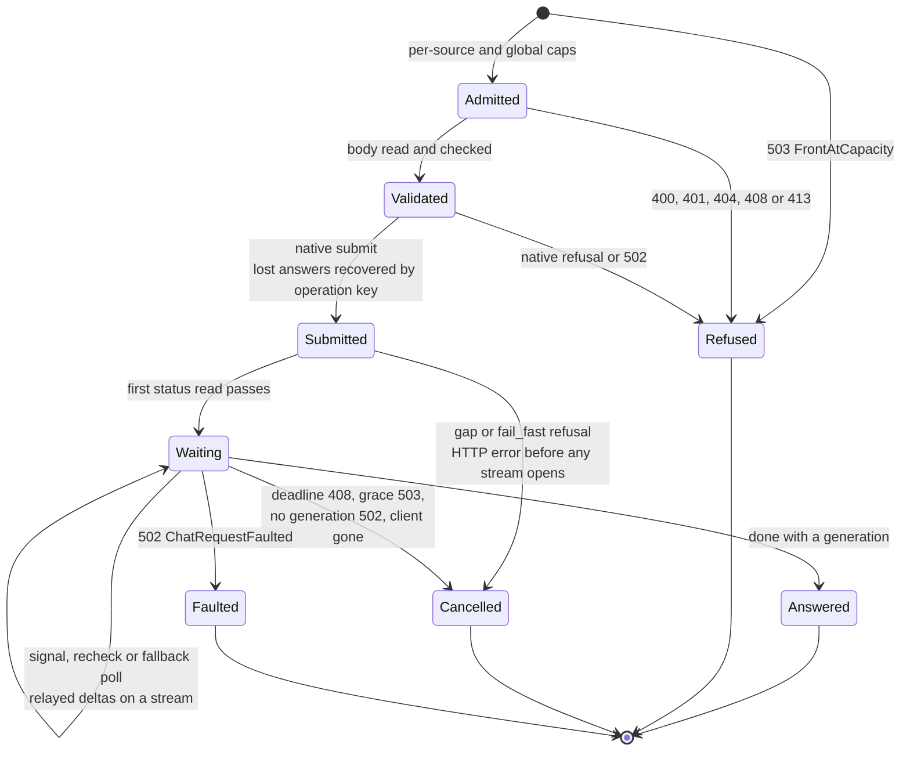
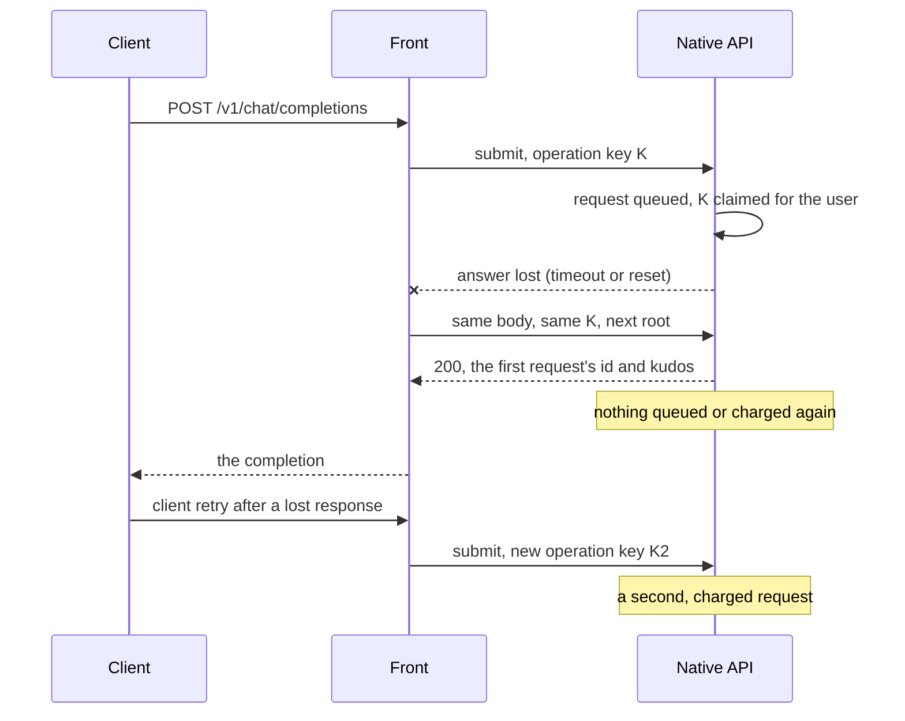
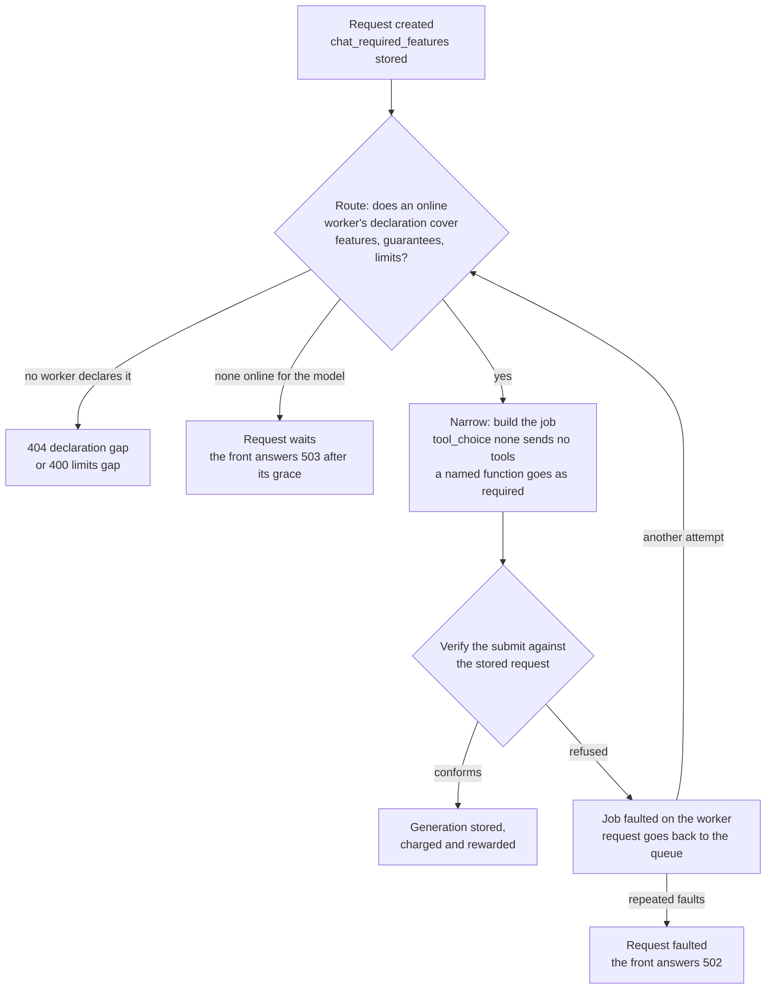
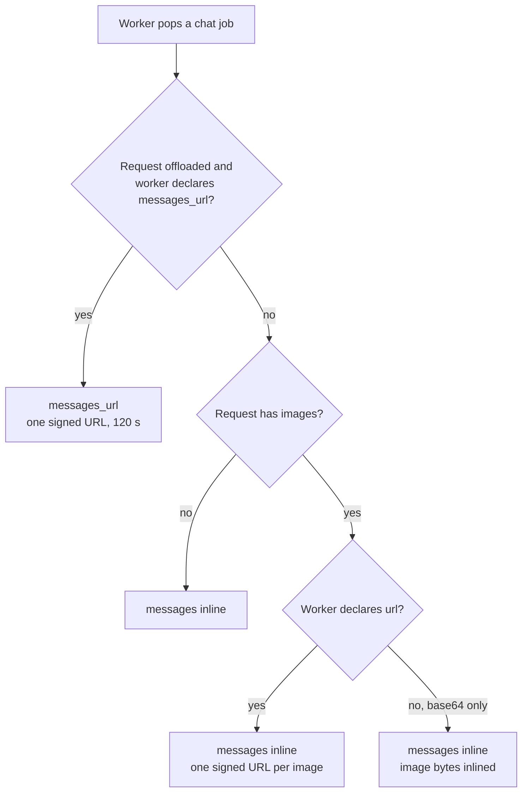
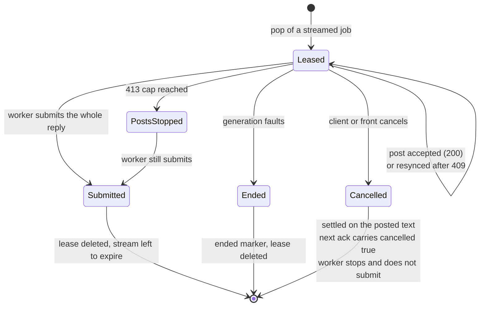

<!--
SPDX-FileCopyrightText: 2026 Tazlin

SPDX-License-Identifier: AGPL-3.0-or-later
-->

# Chat requests on the Horde

<!-- BEGIN GENERATED: topics (gen_doc_index.py) -->
Topics: [chat](../topics.md#chat), [requests](../topics.md#requests), [workers](../topics.md#workers)
<!-- END GENERATED: topics -->

In brief:

- A chat request carries an OpenAI `messages` array to a worker, which renders it with the chat template of the model
  it has loaded. Otherwise it is a text request, and shares the text queue, pricing and limits.
- Workers opt in with fields on every text pop. The horde sends a chat request only to a worker that declared chat
  jobs, the model, limits that fit, and every optional feature the request uses.
- An OpenAI-compatible front, a separate process, speaks `/v1/chat/completions` to clients and the native chat routes
  to the horde, waking on a Redis signal when a reply lands.
- A parameter the service does not implement is refused with its key in the message, so a client receives the answer
  it asked for or an error. Unknown keys inside messages, tool definitions and `tool_choice` are the exception: they
  are dropped, as OpenAI does.
- A streamed request without tools or structured output receives its text as the worker posts progress; any other
  request receives its reply whole. One request yields one choice.

Every field is specified in the [chat requests reference](../reference/chat_requests.md) and the
[chat front reference](../reference/chat_front.md). The decisions below are recorded as ADRs; each section links the
record that holds the drivers and the rejected options.

## The problem: one prompt string for many templates

A native text request carries one prompt string, and the worker feeds it to the model as written. Instruction-tuned
models answer well only when a conversation is rendered in the chat template they were trained on, with that model's
role markers and turn separators. Under a prompt string, the client has to render the template, which means knowing
the template of whichever model and backend picks up the job. A client that guesses wrong gets a degraded answer and
no error.

A structured conversation moves rendering to the one party that knows the template: the worker, which has the model
loaded. It also gives tools, tool results and images a place in the request, which a flat string does not have a
shape for. The shape chosen is OpenAI's chat-completions body, since it is what client libraries, SDKs and agent
frameworks already send.

A prompt string translated from the conversation at submit was the alternative, and is how the pilot proxy works.
It does not need a native change, but the horde would then own every model's chat template and its maintenance, and
tools, images and reported usage would not have a path to the worker
([ADR 0019](../decisions/0019-chat-requests-as-a-text-request-subtype.md)).

## How a chat request travels

A request passes through the front, the native API and a volunteer worker, with Postgres, Redis and object storage
between them. The front does not hold a database connection. It answers from the native status route or, while a
stream is open, from the retained progress stream.

One request, start to finish. The `opt` blocks run only for a streamed request without tools or structured output,
and the loop only when the worker posts progress; every other request skips them and is answered from the final
status.

The front submits over HTTP, subscribes to the request's completion signal, reads the status once when woken, and
answers in the OpenAI shape. A native client can call the chat routes directly and poll the status route.

## Design choices

### Chat as a text request subtype

A chat request is a `TextWaitingPrompt` with a `messages` column and an `is_chat` discriminator
([ADR 0019](../decisions/0019-chat-requests-as-a-text-request-subtype.md)). Queue position, kudos, upfront kudos,
concurrency limits, statistics, countermeasures and moderation apply because the code that applies them to text
requests runs unchanged. The discriminator keeps the route families apart: a chat id is not found on the text routes,
and the reverse.

A separate request class and table would have given chat a single representation, at the price of a second branch
in every text behaviour. The cost of the chosen option is a second representation: the row's `prompt` column holds
the conversation flattened into a string, read by the token estimate, kudos and moderation and not sent to a
worker, and every rewrite validation makes to that string has to be mirrored onto the messages
([Flattened prompt](../reference/chat_requests.md#flattened-prompt)).

### A separate front woken by Redis

An OpenAI call holds its connection open until the reply exists, and a horde request can wait minutes for a worker.
Waiting inside the Flask application would pin a waitress thread per open call, threads that worker pops and submits
share. The front is a separate ASGI process with one event loop, so a wait costs a coroutine
([ADR 0023](../decisions/0023-run-the-chat-front-as-a-separate-asgi-process-woken-by-redis.md)). It does not hold
a database connection: the outcome lives in Postgres and the front reads it through the status route.

The native side publishes a small event on `horde:chat:<request id>` when a generation lands and when a request
ends ([Completion signal](../reference/chat_requests.md#completion-signal)). Publishing is best effort and a message
does not carry text, so a lost message delays an answer until the front's fallback poll and does not change it. Polling
alone was the alternative; its status load grows with the number of open waits.

A request on the front moves through these states. An exit after the submit other than an answer or a fault cancels
the horde request, so a request the client abandons does not keep its place in the queue
([Errors the front returns](../how-to/run_openai_chat_front.md#errors-the-front-returns)):

Once a request reaches `Submitted`, every error the front returns carries `x-should-retry: false`, since a retry would
be a second charged request. A submit whose answer was lost is the one case the front repeats on its own: it sends
the identical body with the same operation key, and the horde returns the request it already holds
([ADR 0026](../decisions/0026-classify-client-retries-and-recover-submits-by-operation-key.md)):

The front does not deduplicate client retries: a fresh client request gets a fresh key, so only the front's
repeat of a submit is recovered.

The costs are operational. The front is one more process to deploy, drain and monitor, a request belongs to the
process that accepted it, and a front that crashes leaves its open requests to run, be charged and go uncollected.

### Capability declaration and routing by features

A worker states what it serves on every text pop: `chat_jobs`, the `model_id`, `chat_limits`, `chat_features` and
`image_transports` ([ADR 0022](../decisions/0022-declare-chat-capabilities-by-pop-fields.md)). A capability is a
property of the loaded model and backend: whether a projector is loaded, whether the template renders tools, how much
context the backend really has. A bridge version string cannot express those, which rules out the version table the
horde uses for image features. The horde does not probe workers; server-side probes would turn claims into evidence,
at the price of worker time before any job.

The request side is computed once. `required_chat_features` derives the features a request needs when it is
created, counting a field at its documented default as absent, and stores them on the row. Eligibility compares the
worker's declaration with that stored list and does not load a candidate's messages
([Eligibility](../reference/chat_requests.md#eligibility)).

Two properties follow. A worker that predates chat never sends `chat_jobs`, so it never receives a job without a
prompt. A worker that declares chat keeps receiving text jobs under its text limits, so opting in does not take
text work away; a worker that wants chat jobs only says so with `prompt_jobs: false`. The cost is trust: a
misconfigured worker can declare a feature it does not honour.

### Guarantees and the conformance mode

A backend can accept every field and still deviate from the contract on purpose: it may render the same prompt for
every `tool_choice`, clamp the temperature when tools are present, or trim a prompt that does not fit. Each is a
reasonable local choice, and over the horde the requester sees only the reply. A capability says the worker acts on an
input; a guarantee says the reply follows that part of the contract exactly
([ADR 0036](../decisions/0036-route-chat-requests-by-declared-guarantees-under-a-conformance-mode.md)). Both share the
`chat_features` list, and a numeric limit such as `tools_max_temperature` joins `chat_limits`.

A request is `strict` unless its `horde` object selects `best_effort`, because the clients that cannot opt in are the
plain OpenAI clients that expect OpenAI behaviour. Under `strict`, `required_chat_features` adds the guarantees the
request relies on to the stored list, so eligibility compares them like features. Under `best_effort` the request does
not require a guarantee. Limits apply in both modes, since a clamped value changes the request, and a mode governs
only how faithfully the reply follows the request.

The contract is held in three layers, each independent of the others. Routing sends a request only to a worker
whose declaration covers it. Dispatch narrows what a job carries where the contract allows: under `tool_choice: none`
the worker does not receive tool definitions, so `none` does not need a guarantee, and a `tool_choice` that specifies
a function reaches the worker as that one function under `required`. The stored request keeps the client's values,
and the submit checks the reply against them.

The submit check does not trust declarations, so a false one costs the worker refused submissions and does not give
the requester a wrong reply. It verifies only what the payload proves. Under `strict` a call under `none`, a missing
or other call under a forced choice, and content that is not the requested JSON or does not match a `strict` schema
are refused; several calls under `parallel_tool_calls: false` are cut to the first, since an OpenAI client would only ever see one.
Because the cut holds whichever worker replied, routing does not require `single_tool_call_enforced`.
Under either mode a call to a function the client did not offer, or two calls sharing an id, is refused, because no
client can dispatch or answer such a reply. A refused submit faults the job on the worker and counts towards faulting
the request, so the check refuses only what OpenAI would never return. A trimmed prompt or a hidden tool-selection pass
does not show in the reply and is not verified.

### Strict handling of unsupported parameters

A key or value the service does not implement is refused with `400 UnsupportedChatParameter`, and the message states
the key ([ADR 0029](../decisions/0029-route-unsupported-parameters-by-declared-support-refusing-by-default.md)). A
field at its documented default counts as omitted, so stock clients that send defaults unprompted still work, and the
front drops a short, fixed list of default no-ops. Capability fields (`tools`, `response_format`, image parts) are never
dropped, since they change the answer. A supported value that no online worker can serve is a different case: the
request is accepted and waits, and the front answers 503 when the native status reports `is_possible` false.

Where OpenAI refuses a request shape, the horde refuses it too, with OpenAI's message and `param`: a `tool_choice` or
`parallel_tool_calls` without tools, a tool history whose calls are not answered right after the assistant message
that made them, and a `strict` schema that leaves an object open or a property optional. A client written against
OpenAI then fails the same way on both services. The rules live in `horde/chat_contract.py`, so the native route and
the front cannot drift apart. A few OpenAI refusals protect only OpenAI's backend, such as a `json_object` request
whose messages never mention JSON; the horde serves those, and a client that depends on the refusal sets
`horde.openai_guards`.

Messages and their nested objects, the `tools` definitions and the `tool_choice` object are the exception: an
unknown key inside them is dropped and not forwarded. Every other object, and the top level, refuses unknown keys.
The split mirrors OpenAI. OpenAI's API ignores unknown keys inside those objects and refuses them at the top level and
inside `response_format` and `stream_options`. It also refuses `tool_calls` on a message other than an assistant
message, which the front refuses too. The OpenAI Python SDK also replays its accumulated streamed reply with
SDK-specific fields, so refusing them would break the SDK's tool loop.

Dropping unsupported fields by default, as OpenRouter does, was the alternative
([ADR 0030](../decisions/0030-route-unsupported-parameters-by-declared-support-ignoring-by-default.md)). It produces
fewer errors and hides a changed answer in a field most clients never read.

The consequence is that quirks get fixed in the client: a client that always sends a field the service does not
serve stops sending it. A value that is a no-op at its default can be added to the front's default table, by key,
as a deliberate change.

### Pricing by the text output estimate

A chat generation is charged and rewarded through the text formula, on the characters of the reply (content plus
each tool call's name and arguments) divided by four, floored at 20 tokens and capped at the requested `max_length`
([ADR 0027](../decisions/0027-price-chat-generations-by-the-text-output-estimate.md),
[Pricing](../reference/chat_requests.md#pricing)). A short reply to a large `max_tokens` is charged for the short
reply. The basis is computed in one function and stored on every generation as `charge_basis: output_estimate`.
A streamed generation the client cancels is settled on the same basis on the content its worker posted before the
cancel, which the Horde measured, so a volunteer worker is paid for what it turned in.

Pricing on the token counts workers report was the alternative
([ADR 0028](../decisions/0028-price-chat-generations-on-reported-completion-tokens.md)). It is fairer per reply and
trusts volunteer reports that are not audited, which would give workers a reason to over-report. The counts are
stored and shown on every generation and never enter the charge, so the alternative can be evaluated on real data.
The cost of the estimate is accuracy: characters approximate tokens poorly for code and
non-English text, and the floor charges a near-empty reply as 20 tokens.

A client can bound what a request may cost with `horde.max_kudos`. The native route compares it with the dry-run
quote, which assumes the full `max_length`, and refuses before anything is queued, held or uploaded. The charge follows
the reply's output estimate, which is usually smaller, so the check is conservative and a refused request might have
cost less
([Kudos cap](../reference/chat_front.md#kudos-cap)).

### Reasoning

A reasoning model writes its thinking before the answer. The worker submits it in `reasoning_content`, separate
from `content`, so a client that does not expect reasoning receives a clean answer, and a block cut
off by `max_tokens` cannot become the reply. The front hides it unless the request sets `horde.include_reasoning`;
the native status shows it either way. It is not priced: the charge and reward are computed on the content and tool
calls, and the worker's `reasoning_tokens` count is shown and never charged, as with every other reported count
([Reasoning](../reference/chat_requests.md#reasoning)).

### Admission against the online pool

Workers are volunteers, and the models online change minute to minute. By default a request waits for a worker for
the front's whole budget. A client that prefers an early answer sets `horde.availability_mode: "fail_fast"`, and the
front decides at the first status read: zero eligible worker threads, or a `wait_time` over the budget left, refuses
the request with 503 `queue_unavailable` and a `Retry-After`, and cancels it. The refusal describes the pool at that
moment and leaves the retry to the client; the same request may be served once workers come online. The estimate
counts the queued work ahead that the request's eligible workers could take and divides it by their throughput
([Queue position and wait time](request_feasibility_and_queue_pressure.md#queue-position-and-wait-time)), so it is
an approximation, and a request may still start sooner or wait longer.

A refusal at the first read arrives before a stream opens, as a plain HTTP error, so a streaming client handles it as
it would any other refused request. The decision waits up to about 2 seconds for a status that carries queue
information, since a request just submitted is absent from the horde's cached queue positions until they refresh
([No eligible worker](../reference/chat_front.md#no-eligible-worker)).

### Images as signed URLs

The horde fetches, checks and normalises each image at submit, stores it as JPEG, and keeps only a reference in the
row ([Images](../reference/chat_requests.md#images)). At pop it signs a download URL per image, after the commits
that release the queue's row lock, and the worker fetches it
([ADR 0032](../decisions/0032-send-chat-images-to-workers-as-signed-urls.md)). A worker that declares only `base64`
receives the bytes inline.

Inlining base64 read from object storage under the row lock was the alternative: a network read inside the lock, and
megabytes in a JSON response. The `base64` transport reads the store after the lock is released. Storing base64 in the
row would load image bytes on every queue scan. The cost of URLs is that object
storage reachability becomes the worker's concern, and a failed fetch is a faulted job.

A deployment can also offload a large request whole: the messages, images inlined, are stored as one JSON object at
submit, and a worker that declares `messages_url` receives one short-lived signed URL in place of `messages`
([Messages offload](../reference/chat_requests.md#messages-offload)). The worker then makes one self-contained fetch
with no partial download to manage, which the koboldcpp maintainer prefers, and large bodies stay off the pop
response. The transport is chosen per generation, from what the request stored and what the popping worker declared:

### Sampling defaults and the developer role

Every chat payload carries every sampling field, with OpenAI's default where the client left one out
([ADR 0033](../decisions/0033-fill-openai-sampling-defaults-and-map-the-developer-role.md)). An omission then means
the same thing on every worker, which a worker's local defaults (koboldcpp's include a repetition penalty) would not
give. The cost is that an operator's tuned defaults never apply to chat jobs.

A `developer` message is stored and sent as `system`, so templates that predate the role can render it. The rewrite
loses the role's precedence over `system`, and the horde does not advertise a developer-role feature while it holds.

### Errors in the OpenAI envelope

The front returns every error as `{"error": {"message", "type", "param", "code", "metadata"}}`, with the horde's
return code as `code`, and uses OpenRouter's status vocabulary where OpenAI does not define a status, such as 502
for a worker or generation failure and 503 for no eligible worker
([ADR 0034](../decisions/0034-map-chat-errors-to-the-openai-envelope-with-openrouter-status-vocabulary.md)). An
envelope mapped onto only 400 and 500 would have made capacity failures indistinguishable from server faults. After
a stream's headers are sent the status is fixed, so a later error arrives as one SSE event carrying the envelope without a
choice, and the front does not make up a finish reason. The full table is in
[Errors the front returns](../how-to/run_openai_chat_front.md#errors-the-front-returns).

### Anonymous access

A request without `Authorization` uses the anonymous key, as the native API allows
([ADR 0035](../decisions/0035-keep-anonymous-access-on-the-chat-front.md)). Anonymous use is the service's proposition
for most users; requiring a key would change what the service is. Abuse is bounded by the existing anonymous limits,
the lowest kudos priority, and per-source caps on the front, which aggregate users behind one address.

### Streaming

A streamed request without tools whose `response_format` is absent or `text` gets its content as the worker posts
progress, one chunk per post, about one a second. The batches are kept in a retained Redis stream per request, cheap
and lost on failover
([ADR 0024](../decisions/0024-stream-chat-deltas-through-a-retained-redis-stream.md)). Postgres progress rows were the
alternative, durable and paid for in primary database writes on the connection pool pops and submits share
([ADR 0025](../decisions/0025-stream-chat-deltas-through-postgres-progress-rows.md)).

A lease in Redis, written at pop, authenticates a generation's posts, so the progress route does not read Postgres.
The lease's life is the streamed generation's life as the worker sees it
([Streaming progress](../reference/chat_requests.md#streaming-progress)):

A cancel settles the generation on the content its worker posted before it, so the worker is paid for that text and
the requester charged for it. The settlement does not count a dropped job, so a worker that stops on the flag is
never penalised for a client leaving. The front relays entries as they arrive and reconciles them with the final
reply: a reply equal to or extending the relayed text completes the stream, and one that diverges ends it with an
error event.

A request with tools or a non-text `response_format` waits for the whole reply as a non-streamed request does, then
sends it as
server-sent events: a role chunk, one content chunk, a tool-call chunk when there are calls, a finish chunk, optional
usage, and `[DONE]` ([Response shape](../reference/chat_front.md#response-shape)).

### Service selection

Horde behaviour without an OpenAI key (worker restrictions, trusted or validated workers, context sizing) travels in
a `horde` object in the request body, which every SDK can send as extra body fields
([ADR 0020](../decisions/0020-select-chat-service-by-request-body-and-model-variants.md)). A request may list
acceptable models in `models` in place of `model`; the Horde serves it with whichever listed model an online worker
runs, as it serves a text request's model list, and the response reports that model. The list states what the client
accepts, so it is the same operation in any order, and an unknown entry refuses the request. Under
`context_fit: truncate_oldest` a history too long for any served context loses its oldest whole turns and keeps every
system and developer message and the latest user turn. Moderation screens the full submitted messages before any
message is dropped. For the request's lifetime its row stores the kept messages, which the worker receives, and, as on
every request, the full flattened submission in `submitted_prompt`. The record also reserves `:variant` suffixes on
the model id for presets that a model picker can show; the front does not serve a variant, and answers 404 for a
model id that contains a colon. Base-URL profiles were the alternative
([ADR 0021](../decisions/0021-select-chat-service-by-base-url-profiles.md)): one configuration per application, at the
price of a resolver and revision store, invisible to model pickers, and lost by clients that hardcode `/v1`.

## What a client can rely on

- **Identity.** A completion's `id` is `chatcmpl-` plus the horde request id, and `x_horde.request_id` carries the
  id alone, so a support question or a native status read can find the request.
- **Charges.** A request costs what the same reply would cost as a text request, reported in `x_horde.kudos` with its
  `charge_basis`. Reported token counts never change it. A lost submit inside the front is recovered by operation key
  without a second charge ([ADR 0026](../decisions/0026-classify-client-retries-and-recover-submits-by-operation-key.md));
  a retry by the client is a new, charged request.
- **The answer asked for.** Every parameter was either honoured by a worker that declared it or refused before the
  request was queued. Under `strict`, a reply's tool calls follow `tool_choice` and `parallel_tool_calls`, and its
  content follows `response_format`, whatever the worker declared.
- **Stream order.** A stream's chunks arrive in the order above, and an error after the headers arrives as one error
  event followed by `[DONE]`.
- **Failure behaviour.** A worker that cannot serve a job faults it and the job goes to another worker. A request that
  no worker can serve is cancelled and answered 503 `no_eligible_worker`; one that faults is answered 502. Once the
  horde may hold a request, every error carries `x-should-retry: false`, so SDKs do not retry into a second charged
  job. Under `horde.availability_mode: "fail_fast"` a 503 `queue_unavailable` is a refusal about the online pool at
  the first status read, and the same request may be served once workers come online.

## What a client cannot rely on

- **Delta streaming.** It covers plain text requests only; a request with tools or structured output streams the reply
  whole after generation, and a relayed stream is best effort, since a lost stream still ends with the full reply.
- **Multiple choices.** `n` other than 1 is refused.
- **Worker selection by quantisation or pinned model.** `horde.quantizations` and `horde.pinned_model` are unknown
  keys and return `400 UnsupportedChatParameter`.
- **Identical answers across workers.** The defaults are the same everywhere; backends, quantisations and templates
  are not.
- **Verified capabilities.** A feature is honoured by a worker that declared it, and the declaration is the worker's
  claim. Only what the reply itself shows is checked; a trimmed prompt or a clamped sampler is not.
- **Token counts.** They are what the worker's backend reported, and null where it did not report them.

## Related

- [Chat requests reference](../reference/chat_requests.md): routes, body, pop declaration, payload, submit, pricing
  and signals.
- [Chat front reference](../reference/chat_front.md): the front's request keys, response shape and metrics.
- [Serve chat jobs from a text worker](../how-to/serve_chat_jobs.md): the worker procedure.
- [Send chat completions through the OpenAI-compatible front](../how-to/send_chat_completions.md): the client
  procedure.
- [Request feasibility and queue pressure](request_feasibility_and_queue_pressure.md): how `is_possible` and the
  queue fields behave, for chat requests as for text.
