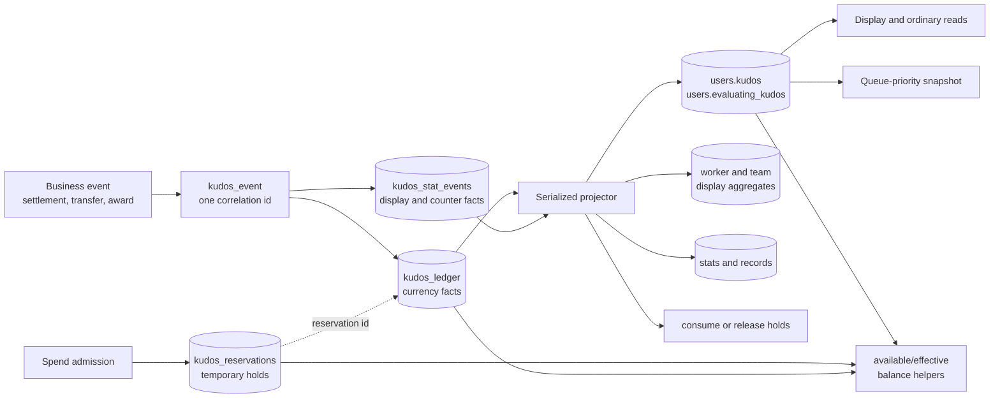
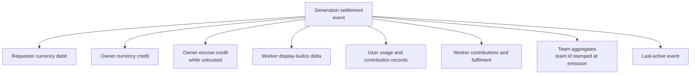
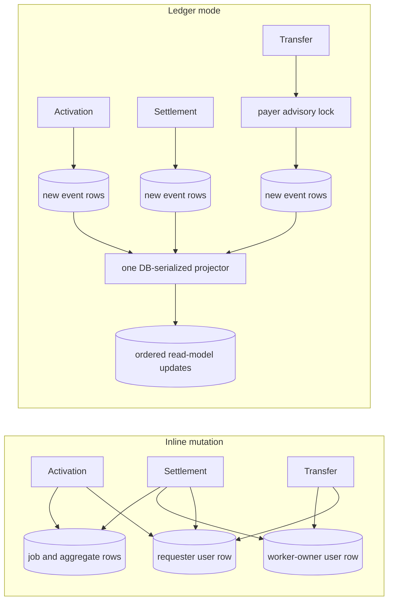
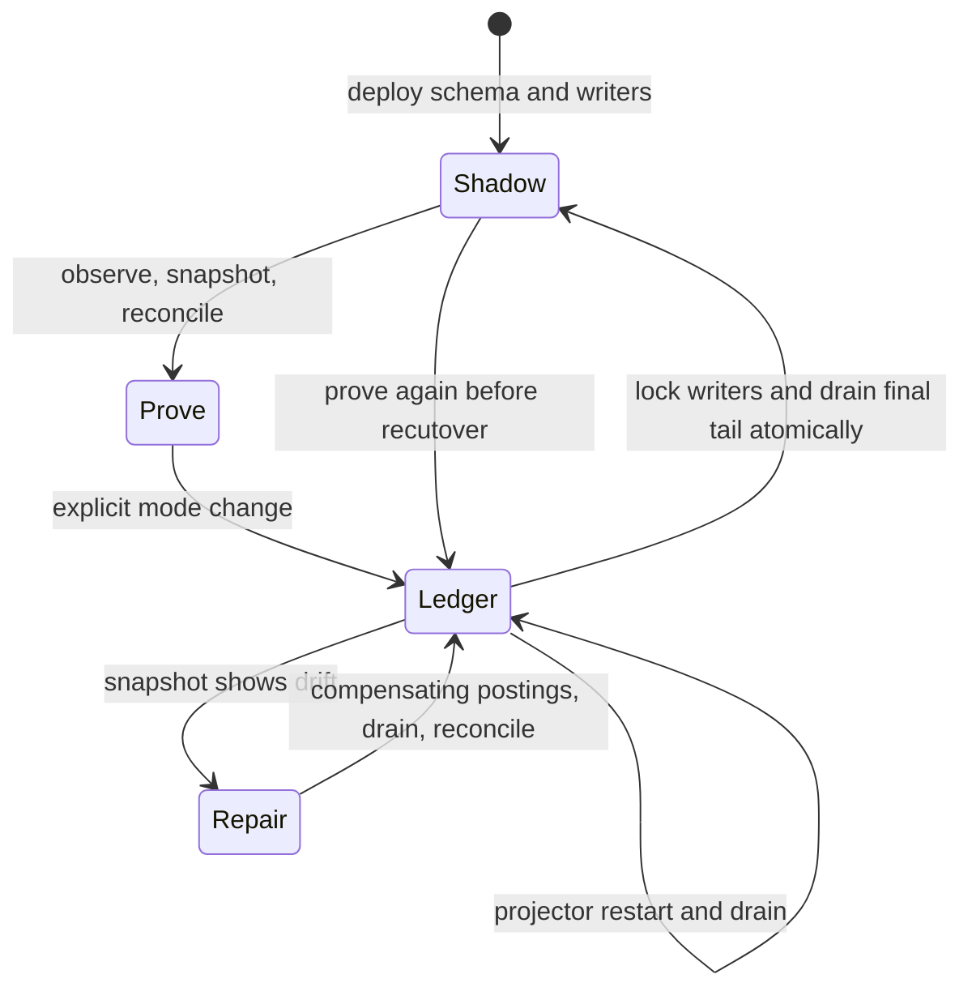

<!--
SPDX-FileCopyrightText: 2026 Tazlin

SPDX-License-Identifier: AGPL-3.0-or-later
-->

# Kudos accounting, projection, and concurrency

<!-- BEGIN GENERATED: topics (gen_doc_index.py) -->
Topics: [accounting](../topics.md#accounting), [kudos](../topics.md#kudos)
<!-- END GENERATED: topics -->

When a request spends kudos or a worker earns them, the Horde records the amount and reason in an event table.
In `ledger` mode, a background task called the projector applies these events to the stored balances and statistics.
The displayed balance can therefore lag behind recent transactions. Reservations prevent that delay from allowing
a user to spend the same kudos twice.

This page explains how events and reservations work together, and where their guarantees end. The exact mutation
rules, field definitions and consumer inventory are in the [kudos accounting reference](../reference/kudos_accounting.md). The
operator sequence for cutover, rollback, and repair is in
[kudos ledger operations](../how-to/kudos_ledger_operations.md). For the user-facing purpose of kudos, see
[What are kudos?](../haidra-assets/docs/kudos.md).

## Inline mutation

Under inline mutation, each request updates the balance columns itself. Request activation, settlement, transfers,
uptime rewards, trust promotion, awards, and administrative adjustments change the stored rows directly inside their
request transactions. The balance columns are then both the way kudos change and the only practical accounting
record.

Busy user rows are then locked by many otherwise unrelated transactions. Operations on several accounts become
sensitive to lock order, and a detailed audit trail does not exist. Recording each movement as an event preserves
the transaction history while allowing balances and statistics to be updated later
([ADR 0001](../decisions/0001-event-sourced-kudos-accounting.md)). The temporary `shadow` mode records the same events
while keeping the inline updates. This allows a comparison and an online, reversible cutover
([ADR 0005](../decisions/0005-shadow-mode-cutover.md)).

## Accounting overview

- API responses and other ordinary reads use the balance and aggregate columns (`users.kudos`, `workers.kudos`, team totals, stats).
  These columns are projections: current values computed from the event history. In `ledger` mode they can lag behind
  the events by one projector interval.
- Currency movements are rows in `kudos_ledger`. Display totals and counters are rows in `kudos_stat_events`. Rows
  from one business event share one `event_id`. Both tables keep exact rows for an online window. After that,
  [retention](#event-retention) replaces them with summaries and an archive.
- Spend admission does not use the raw balance column to decide whether a spend is allowed. It takes the payer lock,
  a database lock on the paying user's ID, and checks `available_kudos`. That value subtracts active reservations and
  queued debits and deliberately ignores queued credits.
- The projector adds each unapplied event into the stored columns. This step is called folding. Rows with
  `applied = false` are the work queue. The projector selects rows by that flag and does not keep a watermark (a saved
  "highest ID processed" position), so a row that commits late is not skipped.
- `shadow` mode is a temporary mode that keeps the inline balance updates. `ledger` mode is an explicit operator
  cutover that can be reversed online.

The models and shared event-writing functions are in `horde/classes/base/kudos.py`. The projector is in
`horde/database/kudos_ledger.py`. The
[code map](../reference/kudos_accounting.md#code-map) covers the rest.

## Event history and projections

### Shared mutable rows {#the-problem-shared-mutable-rows}

Settling one completed job updates several related records:

- the requester's spendable balance, usage totals, records, and last-active time;
- the worker owner's spendable or evaluation balance;
- the worker's display kudos, contribution total, fulfilment count, and action buckets;
- the worker's team aggregates, using the team membership at settlement time;
- the waiting prompt, processing generation, reservation, and transfer metadata that make the business event valid.

Inline mutation performs much of that work inside the request transaction. Concurrent activation and settlement
transactions reach the same user and job rows through different paths, and a transfer always involves two users.
Even when every update is correct, taking locks in an inconsistent order can form a cycle. Transaction A holds a
prompt or source user row while it waits for another user row. Transaction B holds that user row and waits for A's
row. Retrying the transaction that PostgreSQL cancels as the deadlock victim prevents some user-visible failures. It
does not remove the contention or provide an audit trail.

With inline mutation, correctness also depends on timing. Statistics written by read-then-insert race when two
transactions create the first row of a dimension. A crash between related updates is difficult to explain after the
fact. A retry moves the money again when there is not a stable business key. Correcting a balance overwrites the only
visible value instead of adding an auditable compensating fact.

#### Pre-ledger lock contention

Lock-chain and `pg_stat_statements` captures from the production primary measured the cost
([ADR 0001](../decisions/0001-event-sourced-kudos-accounting.md) records when they were taken). The anonymous
requester row (`users.id = 0`) had `Lock:tuple` queues 15 waiters deep even during quiet periods. The mean lock
acquisition was around one second, maxima were in minutes, and at worst single-row balance updates were blocked for
hours. The `FOR NO KEY UPDATE` acquisition was among the slowest operations in `pg_stat_statements`.

Removing the serialization on the users row moved the queue one level down instead of removing it. With balances
appended instead of updated inline, load testing found the anonymous user's `user_stats` row queued 10 to 12 deep
behind multi-second idle-in-transaction holders. Folding the statistics counters into the same event stream removes
the remaining queue, because request transactions then append rows and do not write any shared aggregate row.

The design therefore addresses four related problems:

1. shrink and standardize the lock graph for kudos mutations;
2. make currency movement durable, typed, correlated, and replayable;
3. preserve spend safety while projection is asynchronous;
4. make cutover, rollback, diagnosis, and repair explicit operations instead of improvised database edits.

### Facts, holds and projections {#the-mental-model-facts-holds-and-projections}

Events record accepted changes, reservations hold spend capacity, and projections store totals for reads.
Each has a different role in deciding what a user can spend.

**Facts** record accepted changes. A `KudosLedger` row adds to or subtracts from one user's spendable or evaluation
balance, with amounts stored to two decimal places. A `KudosStatEvent` row changes a statistic or display total.
Rows from the same business event share an `event_id`, but each row can still be claimed and audited separately.

**Holds** record what has already been promised. A reservation belongs to exactly one payer and has a stable
`business_id`. It prevents two concurrent admissions from both relying on the same balance before it is projected
([ADR 0004](../decisions/0004-payer-reservations-for-spend-admission.md)). It is not currency and does not credit a
recipient.

**Projections** let API responses and other reads retrieve totals without summing the event history. These stored
totals include `users.kudos`, `workers.kudos`, team totals and the existing statistics tables. In ledger mode they
can lag behind accepted events by one projector interval. This delay allows request transactions to record events
without updating the shared totals, while keeping reads inexpensive.

This separation also explains why worker "kudos" do not belong in the currency ledger. `workers.kudos` is a display
total attributed to a worker. The actual currency credit belongs to the worker owner in `users.kudos`. Likewise,
contributions and fulfilments are measured in things or counts. Mixing them into one table would make conservation,
reconciliation, and future reporting ambiguous
([ADR 0002](../decisions/0002-separate-currency-and-statistic-event-tables.md)).

### One business event, several postings

The `kudos_event` context assigns a shared event UUID and optional job metadata to related postings. For example, in
ledger mode a normal generation settlement can produce all of the following without directly editing the
corresponding read-model rows:

The exact set varies with trust, cancellation, fake generations, shared keys, and job type. The invariant is that the
business transaction commits its job state and emitted facts together. The event UUID links the postings. It does not
by itself make every producer retry idempotent. Transfers accept an idempotency key from the caller and reject a
replay with different parameters. Other producers rely on their job-state transaction to prevent duplicate
settlement.

When the requester cancels a streamed chat generation, it is settled through the same event. The amount is based on
the content that the worker posted before the cancel, as measured by the Horde. The worker owner is credited and the
requester is debited for that content. The cancel does not count as a dropped job for the worker. A later submit for
the settled generation is refused, so the generation settles once. The Horde does not measure part of a non-streamed
generation, so a non-streamed generation settles on submit
([Chat requests: pricing](chat_requests.md#pricing-by-the-text-output-estimate)).

### Projection: durable work queue

In ledger mode, rows start with `applied = false`. The periodic projector:

1. tries to acquire a PostgreSQL transaction advisory lock, independent of the process-level quorum;
2. claims bounded, ID-ordered currency and statistics batches with `FOR UPDATE SKIP LOCKED`;
3. groups deltas by target and visits materialized targets in stable primary-key order;
4. updates balances, counters, records, worker totals, and team totals;
5. consumes or releases the matching reservations;
6. marks the exact claimed row IDs applied;
7. commits all those changes in the same database transaction.

If the process dies before commit, neither the projection nor the applied flags commit, and a later cycle claims the
rows again. A row with a lower ID can commit after a row with a higher ID was already processed. The lower row stays
`applied = false`, and a later cycle claims it. Rows are not selected by a high-water mark (the highest ID processed so
far), so the late row is not skipped. "Exactly once" here means that each accepted row is folded in exactly one
committed transaction. It does not mean that every business event is created exactly once.

The applier heartbeat records when the projector last completed a cycle. It is deliberately not used as a watermark
for correctness. It only makes a stopped or delayed projector visible.

### Event retention

Exact events stay in PostgreSQL for an online window of at least 30 days. After that, statistic events are replaced
by daily rollups. Currency postings are replaced by per-user checkpoints, daily statements and a verified archive
object. The partition holding the events is then dropped.

Reconciliation reads the latest checkpoint plus the events still online after that checkpoint. Transfer and repair retries are checked against a key table whose rows last as long as the window.
[Kudos event retention](kudos_retention.md) describes the design, the unit lifecycle and the costs. The decision is
recorded in [ADR 0042](../decisions/0042-roll-up-statistics-and-archive-currency-after-the-online-window.md). It
changes what permanent storage means in [ADR 0006](../decisions/0006-permanent-archive-compensation-only-repair.md) and
keeps compensation-only repair.

## Concurrency and spend admission

### Deadlock mitigation

Recording events reduces lock contention because ordinary transactions append new rows instead of taking write
locks on shared balances and statistics. A transfer between accounts
locks only the payer, and admission does not lock the recipient. Projection is done by a single writer, enforced by
the database. It collects a batch and applies each kind of target in a stable order
([ADR 0003](../decisions/0003-single-serialized-projector.md)).

Deadlocks remain possible outside ledger projection. Activation and settlement still change job state and related
non-ledger rows, including shared-key budgets. Database maintenance or unrelated code can also
lock a projection target. The bounded PostgreSQL deadlock retry on waiting-prompt activation is kept for those cases.
The projector itself can be blocked. Its single-writer design gives up write parallelism for a much simpler lock
graph. Queue age, heartbeat age, and database deadlock metrics must therefore be monitored after cutover.

The [concurrency reference](../reference/kudos_accounting.md#concurrency-and-lock-reference) owns the exact
lock order and participating locks. The following mode-transition explanation describes why that order matters.

#### Mode transitions

Every mutation transaction holds the shared mode gate, a transaction-scoped advisory lock, until it commits. This
pins the mode that the transaction read. A mode change takes the gate in exclusive mode, so it cannot proceed until
the writers that read the old mode have committed. Only then does the changed ownership rule take effect. The gate is
an advisory lock instead of a lock on the control row, because heavyweight locks queue fairly. A pin requested while a
transition is waiting queues behind the transition, so the transition's delay is bounded by the longest mutation in
progress.

A row-level `FOR KEY SHARE` lock requested while a `FOR UPDATE` lock is queued takes the no-conflict fast path
instead. Under sustained writer traffic with overlapping pins, the transition is then delayed indefinitely
([ADR 0010](../decisions/0010-advisory-lock-mode-gate.md)).

The transition back to shadow takes the applier lock first and waits for transactions that read ledger mode.
It applies their remaining unapplied events in the same transaction as the mode change. A ledger-mode posting therefore cannot appear after inline projection resumes.

### Reservations make eventual balances spend-safe

Because projection is asynchronous, `users.kudos` alone cannot show whether another debit may be accepted. A user
could have 100 visible kudos and submit two simultaneous 80-kudos transfers. If their debits exist only as pending
ledger rows, the user would appear solvent to both transactions.

Admission closes that window with a transaction-scoped advisory lock derived from the payer's ID. Under that lock,
`available_kudos` subtracts the account floor, active holds, and ordinary queued debits, and deliberately ignores
queued credits. The accepted operation creates or reactivates a reservation with a unique business ID in the same
transaction as its ledger posting.

Projection consumes a request hold as the corresponding debits are applied. It releases a transfer hold
only when the complete event has been applied, including a transfer split across batches.

A request releases what remains of its hold when it completes, is cancelled, is deleted or expires. A cancel
releases the hold while jobs may still be with workers, so a job settled after the cancel debits without a hold.
The posted debit is still subtracted as a queued debit until projection applies it.

A queued credit cannot fund a new spend until it is projected. This can delay work
during projector lag, but it cannot authorize an overspend based on income that is not yet projected.

#### Free output allowance

The [free-output constants](../reference/service_limits.md#free-output-and-image-work) give the defaults, wait
thresholds and rationale, with the defining configuration fields and admission paths.

Not every request takes a hold. A text or chat request within its free output allowance is admitted without one and
charged when its generations settle, so a requester with little or no balance can still use idle capacity. The
allowance depends on the request's estimated wait on its eligible workers. This is the same estimate that the status
route reports as `wait_time`: 4096 tokens up to a minute of queue ahead, falling linearly to 512 at five minutes. Free
output is therefore generous while those workers keep up with their queue, however deep it is, and modest when they
fall behind ([free output allowance](../reference/chat_requests.md#free-output-allowance)).

A free request's charge can take the requester below the account floor. Projection then forgives the shortfall with a
`FLOOR_ADJUSTMENT`, which is how free output is paid for.

#### Effective balance reads

`effective_kudos` adds all committed, unprojected currency deltas to the materialized balance and clamps the result
to the account floor. It is suitable for a "new balance" response or for diagnosis. It must not be used to authorize a
spend, because it includes queued credits and does not account for holds.

## Compatibility and recovery

### Compatibility rules

The ledger changes how kudos movements are written and keeps the established economic policy:

- A debit cannot take an account below `get_min_kudos()`. If projection forgives part of a debit, it emits an already
  applied `FLOOR_ADJUSTMENT` for the created amount, so that replaying the events still gives the projected result.
- Untrusted worker-owner rewards go wholly or partly to `evaluating_kudos`, depending on reward type. The projector
  detects the final contribution that crosses the threshold, grants trust, and emits an escrow-debit/spendable-credit
  pair. A later request is not needed to trigger promotion
  ([ADR 0008](../decisions/0008-trust-promotion-in-the-projector.md)).
- Worker and team aggregates keep historical attribution. The producer stamps the worker's current `team_id` on the
  event, so moving the worker before projection cannot move old credit to a new team.
- Shared-key kudos remain an inline per-key quota. They are not user currency and are not projected by this ledger.
- Job cost fields such as `waiting_prompts.kudos` and `consumed_kudos` are prices and job-local accounting. They are
  not account balances.

Some ordinary reads intentionally remain eventually consistent. Queue priority is copied from the materialized user
balance when a request or interrogation is activated. API and login display paths generally show materialized
balances.

The upfront eligibility recheck for image workers reads the materialized balance, although initial
admission is protected by a reservation. Those paths can be stale by the projector lag. They do not authorize a
second spend, but they can briefly show an old value or make a conservative or optimistic scheduling decision. The
[consumer inventory](../reference/kudos_accounting.md#consumer-and-read-model-inventory) records these sites. A future
change can then deliberately choose `available_kudos`, `effective_kudos`, or the projection instead of blindly
replacing every `.kudos` read.

### Shadow mode

Shadow mode allows operators to compare event history with inline accounting before switching modes. Business
methods emit the same typed events in both modes. In shadow mode, a compatibility projector updates balances inline
and marks the events as applied, preventing the background projector from applying the same changes again.
These events remain available as audit history for the retention window, and [retention](#event-retention) then
replaces them with summaries and, for currency, an archive object. The asynchronous projector handles trust
promotion and the escrow drain only in ledger mode. In shadow mode the compatibility projector handles them, which
keeps the inline balance behavior.

Both modes retain the same event schemas and reservations, so the mode transition changes who applies the
events. The [mutation contract](../reference/kudos_accounting.md#mutation-contract) describes the shared producers;
[operator procedures](../how-to/kudos_ledger_operations.md#online-rollback) describe the reversible cutover.

Shadow history records movements from deployment onward. It does not reconstruct earlier kudos movements.
The existing materialized balances are the opening position. A transaction-consistent snapshot records that opening
position together with the applied-ledger totals visible at the same time.

### Recovery

Recovery uses balance snapshots and the event history to calculate expected balances before making corrections:

A snapshot uses repeatable-read isolation. It records each user's materialized spendable and escrow values plus the
applied ledger totals at that point. Reconciliation computes the expected current values from that baseline and the
events applied later. Read-only reconciliation reports drift. Repair mode emits deterministic `RECONCILIATION`
postings. It does not rewrite a balance, delete a posting, or change an old `applied` flag. Re-running the same repair
cannot duplicate it.

If the projector stops, accepted rows stay durable and unapplied. Restore the projector and drain. If projection is
wrong, preserve evidence, reconcile from a known snapshot, review all drift, emit compensation, drain, and reconcile
again. If the move to ledger mode itself must be rolled back, switch to shadow through the control helper so the
final tail is folded atomically. Rolling back directly to code that does not handle reservations and shadow audit
events is unsafe.

Because of this recovery model, only the retention job removes events, and only after their replacement is committed.
For the same reason, an operator must not "fix" an incident by toggling `applied`, deleting events, or assigning
balances directly. The operational commands and rehearsal checklist are in
[kudos ledger operations](../how-to/kudos_ledger_operations.md).

## Costs and boundaries

The architecture deliberately accepts several costs:

- Normal balance and aggregate reads are only eventually consistent in ledger mode.
- One projector limits write throughput. Bounded batches, a small interval, and a bounded catch-up loop per tick are
  the scaling controls. Sharding the projector would require a new design for ordering and reservations. More threads
  would not be enough.
- Statistic rows older than the window survive only as daily rollups and best-effort dumps. Reading archived currency
  rows means restoring an object instead of running an indexed query. The operator must size the archive budget.
- PostgreSQL provides the production concurrency guarantees, and the unit suite runs against PostgreSQL. The SQLite
  code branches exist only for the legacy `USE_SQLITE` runtime mode. They short-circuit advisory locks, so they do not
  prove anything about concurrent projector behavior.
- Exactly-once projection does not automatically make every producer idempotent. A new mutation that clients can
  retry needs a stable idempotency key and a rule for a retry with conflicting parameters.
- Reconciliation covers user currency and evaluation escrow. Derived statistics are auditable and replayable from
  `kudos_stat_events`, but the snapshot and repair command does not reconcile every worker, team, or counter row.
- Mint and burn events post one side only. A global arithmetic check therefore cannot detect kudos created or
  destroyed by an emission bug. Balancing them against system accounts is proposed in
  [ADR 0009](../decisions/0009-balanced-events-via-system-accounts.md).

Before switching to ledger mode, verify that the event-based balances agree with the inline balances. A safe
cutover requires shadow-mode comparisons, PostgreSQL concurrency tests, a current snapshot, a clean reconciliation, healthy
queue lag, and a rehearsed return to shadow before ledger mode becomes authoritative.
