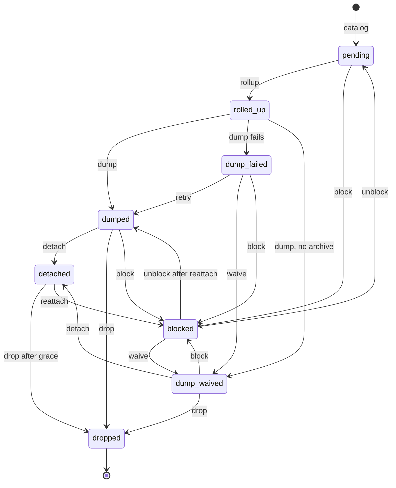
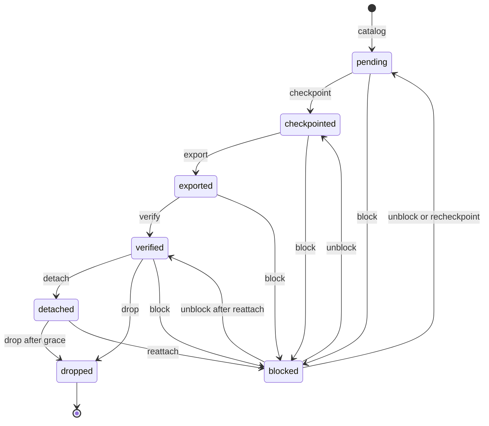

<!--
SPDX-FileCopyrightText: 2026 Tazlin

SPDX-License-Identifier: AGPL-3.0-or-later
-->

# Kudos event retention

<!-- BEGIN GENERATED: topics (gen_doc_index.py) -->
Topics: [accounting](../topics.md#accounting), [kudos](../topics.md#kudos)
<!-- END GENERATED: topics -->

- Exact rows of `kudos_ledger` and `kudos_stat_events` stay in PostgreSQL for an online window of at least 30 days.
  Both tables are range-partitioned by `created`, and a partition leaves the database as a whole once it is older
  than the window.
- Statistic events are replaced by daily rollups that keep every attribution key. The raw rows survive only in a
  best-effort archive dump.
- Currency postings are replaced by per-user checkpoints and daily statements, and the rows themselves go to an
  archive object that is read back and verified before the drop.
- A drop is irreversible. It waits until the replacement is committed, the archive object is verified for currency,
  and a recount shows the partition still holds what the replacement recorded. An optional grace period keeps the
  detached table for a rollback.
- The ledger model this sits on is in [kudos accounting](kudos_accounting.md). The states, settings and metrics are
  in the [event retention reference](../reference/kudos_accounting.md#event-retention). The operator procedures are
  in [kudos ledger operations](../how-to/kudos_ledger_operations.md#enabling-retention).

## Unbounded event tables

Every business event appends one or two currency rows and several statistic rows. Without retention neither table
is bounded, and storage, backups, replicas and the all-time reconciliation aggregate grow with the lifetime of the
service.

Nothing online reads an old event row except three code paths. Every other reader uses the materialized projections,
and spend admission and worker deletion read only unapplied rows. Each of the three reads a replacement instead:

| Reader | What it needed from old rows | What it reads now |
| --- | --- | --- |
| Reconciliation | The all-time sum of each user's applied postings | The latest checkpoint plus the applied online tail at or above its boundary |
| Transfer idempotency | A prior transfer's postings by `event_id`, to replay it or detect a parameter conflict | `kudos_idempotency_keys`, written in the same transaction as the postings |
| Repair idempotency | The `RECONCILIATION` posting of an earlier repair | The same key table. Repair refuses a snapshot older than the key lifetime |

Keys live as long as the shorter online window. A transfer retried after that with the same key is a new transfer,
and a repair needs a fresh snapshot. The
[idempotency key lifetime](../reference/kudos_accounting.md#idempotency-key-lifetime) section has the exact rules.

The rejected alternative archives both datasets row for row forever, seals id ranges behind a writer barrier under
the exclusive mode gate, and migrates to id-range partitions through a mirrored backfill. Its checkpoint boundary sits
at the present moment, which is what requires the barrier, and it moves the growth into the object store instead of
removing it. [ADR 42](../decisions/0042-roll-up-statistics-and-archive-currency-after-the-online-window.md) records
the decision and the other options it weighed.

## Partitions by age

Both event tables are partitioned by `RANGE (created)`. `created` is set when the row is written, so a row that
commits late still lands in the partition of its write time. A partition is eligible for removal once its upper bound
is older than its dataset's window. A transaction that is still open cannot write into a partition whose upper bound
is a whole window in the past, so eligibility by age does not need a writer barrier, sequence sealing or a drain under
the mode gate. The drop still recounts the rows, because a clock fault or a reference time moved forward on a live
database can put a row where the age argument says none can be.

Two policy numbers shape retention. The online window, per dataset, is how long exact rows stay queryable. It can be
raised and never goes below 30 days. The partition width, one week by default, sets the granularity of removal and
adds to the effective retention, since a row waits for the whole partition to age out. The pre-partition history is
one legacy partition, processed in width-sized sub-ranges so its replacements stay bounded. Each partition or
sub-range is a retention unit with one row in `kudos_retention_catalog`.

| Dataset | Replacement in PostgreSQL | Archive | What the drop proves |
| --- | --- | --- | --- |
| Statistics (`kudos_stat_events`) | Rollups per UTC day and full attribution key, whose totals match the unit's totals in the same transaction. Quarantined rows move unchanged to `kudos_stat_quarantine` | A compressed dump, written best-effort and retried. It is not read back, and the budget evicts the oldest dumps first | The rollup is committed, and a recount matches the row count and highest id recorded with it |
| Currency (`kudos_ledger`) | Per-user cumulative checkpoints at the unit's upper bound and per-user daily statements, committed in one repeatable-read transaction | A compressed object with a manifest of control totals, read back and checked against the manifest and the online rows. The budget never evicts it | The checkpoint is committed, the object is verified, and a recount matches the row count and highest id recorded with the checkpoint |

A checkpoint is a sum of events, so drift that exists when the checkpoint is taken stays visible to reconciliation
afterwards. The archive layout and manifest fields are in
[archive objects](../reference/kudos_accounting.md#archive-objects).

## Unit lifecycle

A unit moves through recorded states, at most one transition per tick, and each transition commits its database work in
one transaction. Object I/O runs outside any transaction and the catalog row is updated after it returns, so a crash
repeats a step instead of skipping it. A step that raises does not make a transition and runs again on the next tick.
A unit that cannot proceed safely becomes `blocked` with a reason, and only an operator moves it on. Any state except
`dropped` can become `blocked`. The diagrams show the edges where blocking is expected. The full transition rules are
in [retention states](../reference/kudos_accounting.md#retention-states).

`detached` appears only when a drop grace period is configured. Without one, the drop-ready state goes straight to
`dropped`.

### Statistics units

Blocked statistics units are skipped, and later units continue, because statistic units do not chain.

### Currency units

Each currency checkpoint chains from the previous one, so a blocked currency unit stops the currency dataset and
every later unit stays online. Unblocking returns a unit with a committed checkpoint to `checkpointed`, so export and
verification run again. `recheckpoint` returns the unit and every later currency unit to `pending`, which recomputes
the tail of the chain after rows arrived late. Without an archive, currency units stop at `checkpointed` and their
partitions stay online.

## Properties and costs

The design buys these properties:

- Removal without a writer barrier. Removal by age leaves producers, the projector and the mode gate as they are.
- Resumable from the catalog. Every transition is recorded, so a crash or restart continues from the last committed
  state.
- Proven drops. A partition is dropped only after its replacement is committed and checked, and a recount before
  and after the detach matches the counts the replacement recorded. A partition with an unapplied row is not
  removed.
- A reattach window. With a drop grace period, a detached partition stays as a standalone table and can be attached
  again until the grace ends.
- A verified currency archive. Every archived currency object is read back and matched against its manifest and the
  online rows before the drop, and the budget never evicts one.
- Best-effort statistics dumps with retries. A failed dump is retried for a configured period and does not block the
  rollup. An unavailable archive pauses currency retention and statistics dumps, while writes, projection and
  rollups continue.

It costs these:

- The replacement tables grow. Each currency unit writes a checkpoint row for every user with any contributing
  posting up to its boundary, since a checkpoint is cumulative and earlier boundaries are kept. Daily statements grow
  with per-user activity and rollups with the number of distinct attribution keys per day. These tables do not have
  a retention of their own.
- The archive budget is the only cap on the archive. Currency objects are exempt from eviction, so once the currency
  tier would exceed the budget, currency retention stops until the budget is raised.
- Per-job statistic detail older than the window survives only in dumps that the budget has not evicted. Reading an
  archived currency row means restoring an object into a scratch table.
- Some decisions stay with the operator: what to do with a blocked unit, whether to waive a statistics dump that
  keeps failing, and how large the archive budget is.

## Diagnosing retention

`retention status` and the retention metrics show where each unit stands. The
[metrics and log lines](../reference/kudos_accounting.md#retention-metrics-and-log-lines) are in the reference.

| Symptom | Meaning | Where it is handled |
| --- | --- | --- |
| Blocked, `unapplied rows` | The projector has not folded rows in an eligible unit | [Handling a blocked unit](../how-to/kudos_ledger_operations.md#handling-a-blocked-unit) |
| Blocked, `checkpoint chain gap` or `boundary already checkpointed` | The catalog or the partitions were changed outside the retention job | [Handling a blocked unit](../how-to/kudos_ledger_operations.md#handling-a-blocked-unit) |
| Blocked, `currency tier would exceed budget` | The currency export would pass the archive budget. Currency retention stops and statistics continue | [Handling a blocked unit](../how-to/kudos_ledger_operations.md#handling-a-blocked-unit) |
| Blocked, `archive mismatch` | The object read back disagrees with its manifest | [Handling a blocked unit](../how-to/kudos_ledger_operations.md#handling-a-blocked-unit) |
| Blocked, `online drift since export` or `late rows` | Rows in the unit changed after its replacement recorded them | [Recovering from a late-row or chain block](../how-to/kudos_ledger_operations.md#recovering-from-a-late-row-or-chain-block) |
| `dump_failed`, or blocked with `dump retries exhausted` | Statistics dumps are failing, and the rollup is already committed | [Handling a blocked unit](../how-to/kudos_ledger_operations.md#handling-a-blocked-unit) |
| Held partitions | `KUDOS_RETENTION_HOLD_DROPS` keeps drop-ready partitions attached. Every other step runs | [Enabling retention](../how-to/kudos_ledger_operations.md#enabling-retention) |
| Detached partitions | The partition is inside its drop grace and can still be attached again | [Rolling back a removed partition](../how-to/kudos_ledger_operations.md#rolling-back-a-removed-partition) |
| Outcome `deferred` | Another session holds a lock on the partition or its parent, and the drop is tried again on the next tick | [Retention units](../reference/kudos_accounting.md#retention-units) |
| Outcome `refused` | The tick's reference time is later than the real clock, and the live-data-loss confirmation is absent | [Rehearsing partition removal](../how-to/kudos_ledger_operations.md#rehearsing-partition-removal-on-a-restored-copy) |
| Outcome `failed` on every tick | A step raises each time, for example an unreachable archive | [Recovering from a late-row or chain block](../how-to/kudos_ledger_operations.md#recovering-from-a-late-row-or-chain-block) |

## Code map

| Concept | File | Symbol |
| --- | --- | --- |
| Policy, tick, step selection and block reasons | `horde/database/kudos_retention.py` | `KudosRetentionPolicy`, `run_retention_tick`, `select_next_unit`, `STEP_TABLE`, `RetentionBlockReason` |
| Operator transitions | `horde/database/kudos_retention.py` | `unblock_unit`, `reattach_partition` |
| Archive client, manifest and budget | `horde/kudos_archive.py` | `KudosArchive`, `ArchiveManifest`, `ArchiveTier` |
| Partitions and retention models | `horde/classes/base/kudos.py` | `ensure_kudos_event_partitions`, `KudosRetentionUnit`, `KudosStatRollup`, `KudosLedgerCheckpoint` |
| Checkpoint plus online tail | `horde/database/kudos_reconciliation.py` | `_applied_totals_subquery` |
| Scheduled tick | `horde/database/threads.py` | `kudos_retention_tick` |
| Operator commands | `tools/kudos_ledger_admin.py` | `main` |

The full map, including the migration and the idempotency keys, is the
[kudos accounting code map](../reference/kudos_accounting.md#code-map).
