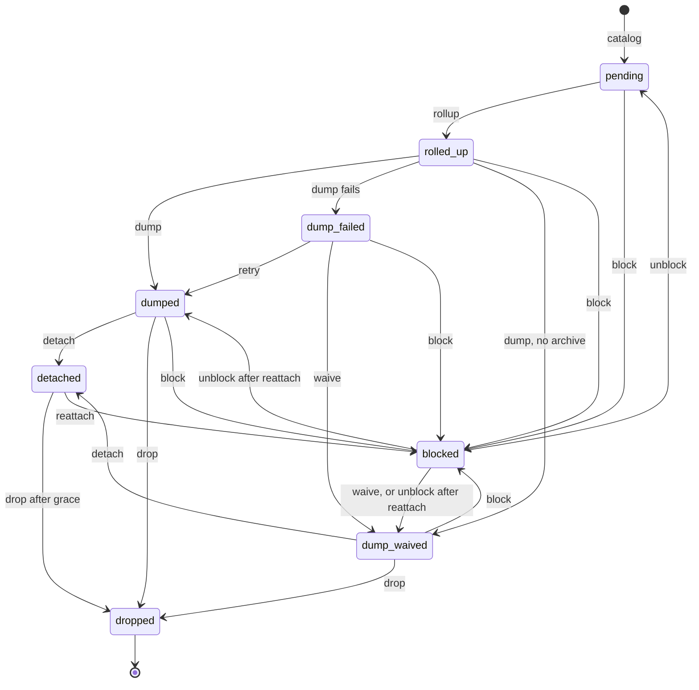
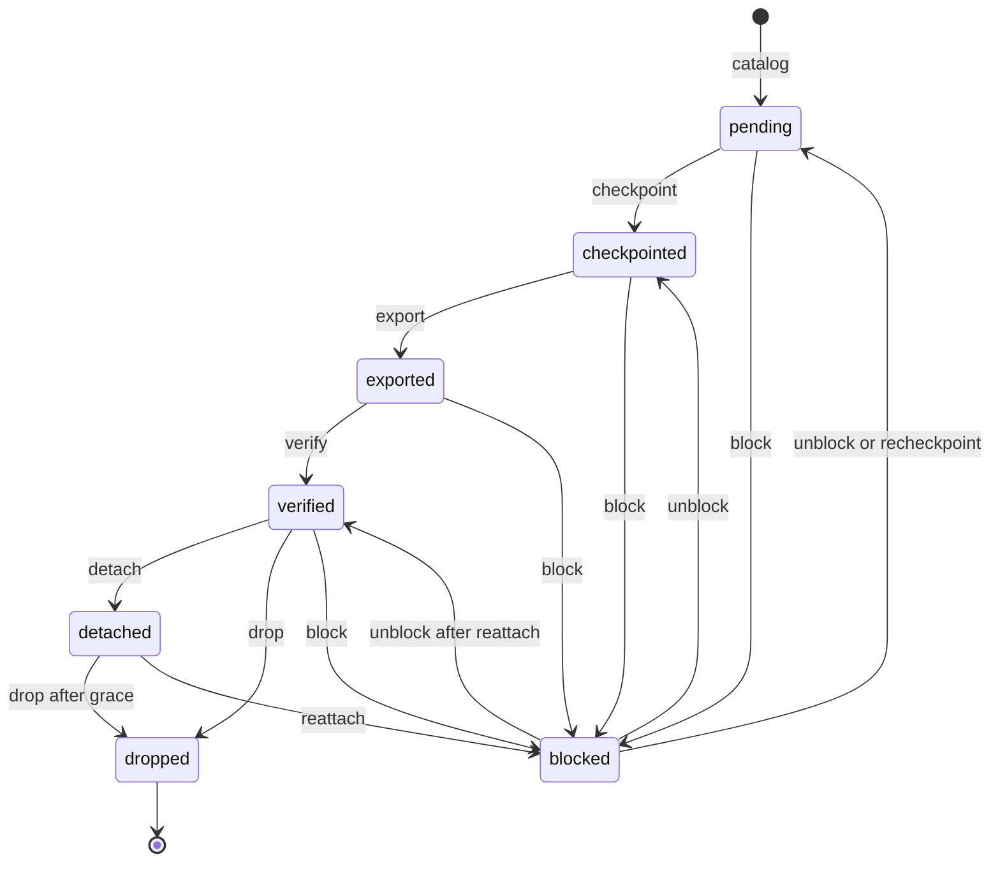

<!--
SPDX-FileCopyrightText: 2026 Tazlin

SPDX-License-Identifier: AGPL-3.0-or-later
-->

# Kudos event retention

<!-- BEGIN GENERATED: topics (gen_doc_index.py) -->
Topics: [accounting](../topics.md#accounting), [kudos](../topics.md#kudos)
<!-- END GENERATED: topics -->

- Exact rows of `kudos_ledger` and `kudos_stat_events` stay in PostgreSQL for an online window of at least 30 days.
  Both tables are range-partitioned by `created`. A whole partition is removed from the database once it is older
  than the window.
- Statistic events are replaced by daily rollups that keep every attribution key. The raw rows survive only in a
  best-effort archive dump.
- Currency postings are replaced by per-user checkpoints and daily statements. The rows themselves go to an archive
  object, which is read back and verified before the drop.
- Before a partition is detached, its replacement must be committed and a recount must match the recorded rows.
  Currency partitions also require a verified archive object. The detached table remains in the database for a grace
  period of seven days by default, during which it can be attached again. Dropping the table after that period is
  irreversible.
- The ledger model under retention is described in [kudos accounting](kudos_accounting.md). The states, settings and
  metrics are in the [event retention reference](../reference/kudos_accounting.md#event-retention). The operator
  procedures are in [kudos ledger operations](../how-to/kudos_ledger_operations.md#enabling-retention).

## Unbounded event tables

Every business event appends one or two currency rows and several statistic rows. Without retention, both tables grow
without a limit. Storage, backups, replicas and the all-time reconciliation aggregate then grow with the lifetime of
the service.

Only three online code paths read old event rows. Every other reader uses the materialized projections, and spend
admission and worker deletion read only unapplied rows. Each of the three code paths reads a replacement instead:

| Reader | What it needed from old rows | What it reads |
| --- | --- | --- |
| Reconciliation | The all-time sum of each user's applied postings | The latest checkpoint plus the applied online tail at or above its boundary |
| Transfer idempotency | A prior transfer's postings by `event_id`, to replay it or detect a parameter conflict | `kudos_idempotency_keys`, written in the same transaction as the postings |
| Repair idempotency | The `RECONCILIATION` posting of an earlier repair | The same key table. Repair refuses a snapshot older than the key lifetime |

A key is kept for the shorter of the two online windows. After that, a transfer retried with the same key is a new
transfer, and a repair needs a fresh snapshot. The
[idempotency key lifetime](../reference/kudos_accounting.md#idempotency-key-lifetime) section has the exact rules.

Archiving every row of both datasets indefinitely would preserve more detail, but storage would continue growing in
the object store. The alternative design also grouped rows by ID and required a writer barrier to prevent new writes
while establishing a checkpoint. Age-based partitions avoid that coordination for ordinary retention work.
[ADR 42](../decisions/0042-roll-up-statistics-and-archive-currency-after-the-online-window.md) records the decision
and the other options that were considered.

## Partitions by age

Both event tables are partitioned by `RANGE (created)`. `created` is set when the row is written, so a row that
commits late still lands in the partition of its write time. A unit is eligible for removal once its upper bound
is older than its dataset's window. A weekly partition is one unit. The legacy partition is processed sub-range by
sub-range, and it is dropped only once its last sub-range is ready. A transaction that is still open cannot write
into a range whose upper bound is a whole window in the past. Eligibility by age therefore does not need a writer
barrier, sequence sealing or a drain under the mode gate. The drop still recounts the rows, because a clock fault, or
a reference time moved forward on a live database, can put a row into a range that the age argument treats as closed.

Two policy numbers shape retention. The online window, per dataset, is how long exact rows stay queryable. It can be
raised and cannot be set below 30 days. The partition width, one week by default, sets the granularity of removal. It
also adds to the effective retention, because a row stays until its whole partition is old enough. The history from
before partitioning is one legacy partition. It is processed in sub-ranges of one partition width each, so that each
replacement stays bounded. Each partition or sub-range is a retention unit with one row in
`kudos_retention_catalog`.

| Dataset | Replacement in PostgreSQL | Archive | What the drop proves |
| --- | --- | --- | --- |
| Statistics (`kudos_stat_events`) | Rollups per UTC day and full attribution key. Their totals match the unit's totals in the same transaction. Quarantined rows move unchanged to `kudos_stat_quarantine` | A compressed dump, written best-effort and retried. It is not read back by the tick, and only an operator evicts it | The rollup is committed, and a recount matches the row count and highest id recorded with it |
| Currency (`kudos_ledger`) | Per-user cumulative checkpoints at the unit's upper bound and per-user daily statements, committed in one repeatable-read transaction | A compressed object with a manifest of control totals, read back and checked against the manifest and the online rows. It is never evicted | The checkpoint is committed, the object is verified, and a recount matches the row count and highest id recorded with the checkpoint |

A checkpoint is a sum of events. Drift that exists when the checkpoint is taken therefore stays visible to
reconciliation afterwards. The archive layout and manifest fields are in
[archive objects](../reference/kudos_accounting.md#archive-objects).

## Unit lifecycle

A unit moves through recorded states, with at most one transition per tick. Each transition commits its database
work in one transaction. Object I/O runs outside any transaction, and the catalog row is updated after the I/O
returns, so a crash repeats a step instead of skipping it. A step that raises an error does not make a transition and
runs again on the next tick. A unit that cannot proceed safely becomes `blocked` with a reason, and only an operator
can move it on. Any state except `dropped` can become `blocked`. The diagrams show the edges where blocking is
expected. The full transition rules are in [retention states](../reference/kudos_accounting.md#retention-states).

`detached` appears only while the drop grace period is above zero, as it is by default. With the grace set to zero,
the drop-ready state goes straight to `dropped`.

### Statistics units

Blocked statistics units are skipped, and later units continue, because statistics units do not form a chain.

### Currency units

Each currency checkpoint builds on the previous one. A blocked currency unit therefore stops the currency dataset,
and every later unit stays online. Unblocking returns a unit with a committed checkpoint to `checkpointed`, so export
and verification run again. `recheckpoint` returns the unit and every later currency unit to `pending`. This
recomputes the tail of the chain after rows arrived late. Without an archive, currency units stop at `checkpointed`
and their partitions stay online.

## Properties and costs

The design has these properties:

- Removal without a writer barrier. Removal by age leaves producers, the projector and the mode gate as they are.
- Resumable from the catalog. Every transition is recorded, so a crash or restart continues from the last committed
  state.
- Proven drops. A partition is dropped only after its replacement is committed and checked, and a recount before
  and after the detach matches the counts recorded with the replacement. A partition with an unapplied row is not
  removed.
- A reattach window. With a drop grace period, seven days by default, a detached partition stays as a standalone
  table and can be attached again until the grace ends. A grace of zero has to be set explicitly, so a deployment
  whose environment lost the setting still keeps the window.
- A verified currency archive. Every archived currency object is read back and matched against its manifest and the
  online rows before the drop. Currency objects are not evicted.
- Best-effort statistics dumps with retries. A failed dump is retried for a configured period and does not block the
  rollup. An unavailable archive pauses currency retention and statistics dumps, while writes, projection and
  rollups continue.

Its costs are:

- The replacement tables grow. Each currency unit writes a checkpoint row for every user with any contributing
  posting up to its boundary, because a checkpoint is cumulative and earlier boundaries are kept. Daily statements
  grow with per-user activity, and rollups grow with the number of distinct attribution keys per day. These tables do
  not have a retention of their own.
- Each tier's budget is the only cap on that tier, and objects are not evicted automatically. Once a tier would exceed
  its budget, the units that would write to it block until the budget is raised or, for statistics, an operator
  evicts old dumps.
- Per-job statistic detail older than the window survives only in dumps that an operator has not evicted. Reading an
  archived currency row means restoring an object into a scratch table.
- Some decisions stay with the operator: what to do with a blocked unit, whether to waive a statistics dump that
  keeps failing, how large each tier's budget is, and when to evict statistics dumps.

## Diagnosing retention

`retention status` and the retention metrics show where each unit stands. The
[metrics and log lines](../reference/kudos_accounting.md#retention-metrics-and-log-lines) are in the reference.

Begin with the unit's state and error from `retention status`. A blocked currency unit stops later currency
units because their checkpoints form a chain; blocked statistics units can be skipped. Held or detached partitions
can be expected under the configured hold and grace policy.

Use [Handling a blocked unit](../how-to/kudos_ledger_operations.md#handling-a-blocked-unit) for the diagnostic
queries and recovery actions, and [retention states](../reference/kudos_accounting.md#retention-states) for the
complete state contract. A failed archive operation requires diagnosing the failure; clearing a block alone
does not repair its cause. For a partition still inside its grace period, use
[Rolling back a removed partition](../how-to/kudos_ledger_operations.md#rolling-back-a-removed-partition).

## Code map

| Concept | File | Symbol |
| --- | --- | --- |
| Policy, tick, step selection and block reasons | `horde/database/kudos_retention.py` | `KudosRetentionPolicy`, `run_retention_tick`, `select_next_unit`, `STEP_TABLE`, `RetentionBlockReason` |
| Operator transitions | `horde/database/kudos_retention.py` | `unblock_unit`, `reattach_partition` |
| Archive client, manifest and budget | `horde/kudos_archive.py` | `KudosArchive`, `ArchiveManifest`, `ArchiveTier` |
| Partitions and retention models | `horde/classes/base/kudos.py` | `ensure_kudos_event_partitions`, `KudosRetentionUnit`, `KudosStatRollup`, `KudosLedgerCheckpoint` |
| Checkpoint plus online tail | `horde/database/kudos_reconciliation.py` | `_applied_totals_subquery` |
| Scheduled tick and archive housekeeping jobs | `horde/database/threads.py` | `kudos_retention_tick`, `reconcile_kudos_archive_catalog`, `abort_stale_kudos_archive_uploads` |
| Operator commands | `tools/kudos_ledger_admin.py` | `main` |

The full map, including the migration and the idempotency keys, is in the
[kudos accounting code map](../reference/kudos_accounting.md#code-map).
