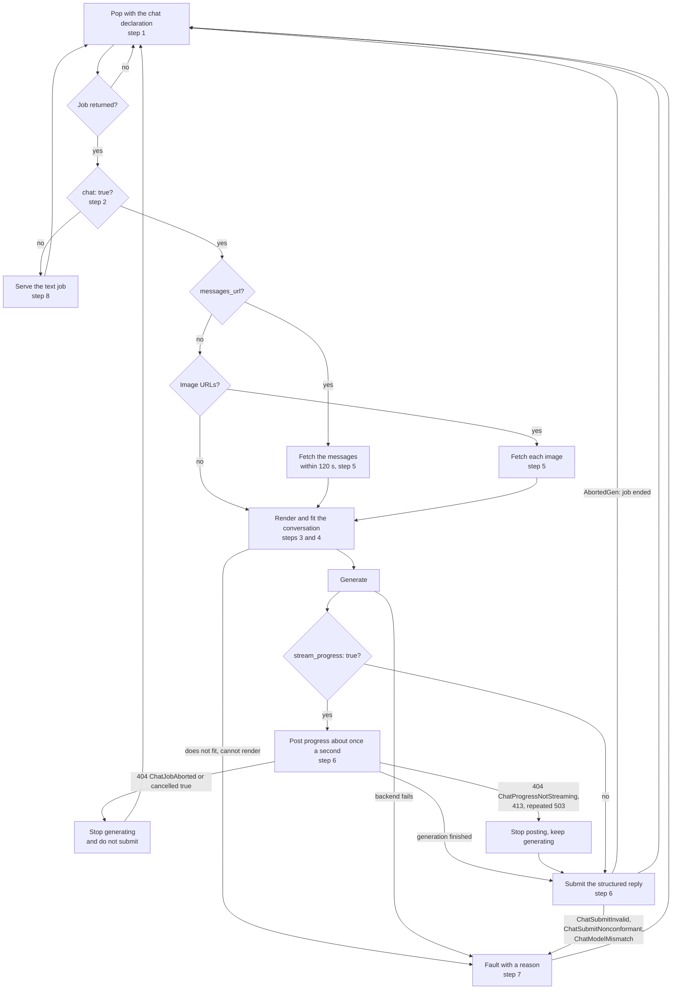

<!--
SPDX-FileCopyrightText: 2026 Tazlin

SPDX-License-Identifier: AGPL-3.0-or-later
-->

# Serve chat jobs from a text worker

<!-- BEGIN GENERATED: topics (gen_doc_index.py) -->
Topics: [chat](../topics.md#chat), [workers](../topics.md#workers)
<!-- END GENERATED: topics -->

To serve chat jobs, add a chat declaration to text pop, render each conversation with the loaded model's chat
template, then submit a structured assistant message. The worker can continue serving text jobs through the same loop.

You need:

- A text worker using `POST /api/v2/generate/text/pop` and `POST /api/v2/generate/text/submit` with a registered API key.
- A backend that renders the loaded model's chat template and counts the rendered tokens.
- A Horde at `<HORDE_URL>` with the `/api/v2/generate/chat` routes enabled.

After integration, the model appears in `GET <HORDE_URL>/api/v2/status/models?type=text&chat=true` with the
declared capabilities and limits. The worker completes supported chat jobs and faults jobs that it cannot serve.

Use the [chat requests reference](../reference/chat_requests.md) for field definitions. Python workers can use
`horde_sdk.worker.chat_declaration`: `declare_from_backend`, `ChatJobPayload`, `build_chat_reply_submit`
and `build_chat_fault_submit`.

For an end-to-end run with koboldcpp, follow
[Serve your first chat job](../tutorial/first_chat_worker.md). For the design rationale, see
[Chat requests on the Horde](../explanation/chat_requests.md). To send client requests, see
[Send chat completions](send_chat_completions.md).

## One chat job in full

A worker adds its chat declaration to every pop, beside the usual text fields. The example in
[step 1](#1-declare-chat-on-pop) declares two optional features, the limits and the model, without image support.
It serves `best_effort` requests. To serve default `strict` requests, also implement and declare
`prompt_overflow_refused`, as described under [Features and guarantees](#features-and-guarantees).

A chat job arrives with `chat: true` and the conversation in `payload.messages`:

```json
--8<-- "docs/reference/chat_wire_examples.md:pop-chat-job"
```

The worker renders `payload.messages` with its chat template, generates, and submits an assistant message:

```json
--8<-- "docs/reference/chat_wire_examples.md:submit-reply"
```

The submit returns the worker's earned kudos:

```json
--8<-- "docs/reference/chat_wire_examples.md:submit-reply-response"
```

Every other body that a worker sends or receives (tools, images, offloaded messages, faults, progress posts, refusals
and worker details) is in [Chat wire examples](../reference/chat_wire_examples.md#worker), checked against the running
code. [Write a minimal chat worker](write_a_minimal_chat_worker.md) is a complete worker for an OpenAI-compatible
backend in one file.

## The pop loop

The pop loop branches on the job type, checks that chat input fits, then generates and submits a reply.
The diagram links each part of that loop to its implementation step:



A failed fetch is a fault too, sent without `fault_reason`.

Every job has a 150-second deadline from pop to submit, which progress posts can extend. Read
[Time and speed limits](#time-and-speed-limits) before choosing `chat_limits.max_length`.

## 1. Declare chat on pop

Add five fields to every pop body, beside the usual `name`, `models`, `max_length` and `max_context_length`
([Chat declaration on pop](../reference/chat_requests.md#chat-declaration-on-pop)):

```json
{
  "chat_jobs": true,
  "chat_features": ["seed", "presence_penalty"],
  "chat_limits": {"max_context_length": 4096, "max_length": 512},
  "model_id": "<model-name>",
  "image_transports": []
}
```

### Chat opt-in

`chat_jobs: true` opts in. The Horde stores the declaration from every pop, so a pop without `chat_jobs` withdraws
it, and the worker does not receive a chat job from that pop.

### Features and guarantees

`chat_features` lists the backend's supported optional features. Declare a feature only when the backend
implements it. The Horde does not test declarations. A request that needs a feature waits for a worker that declares
it. Omitting a feature excludes the worker only from requests that require that feature. Unknown values are ignored.

| Feature             | The worker promises                                                                 |
| ------------------- | ----------------------------------------------------------------------------------- |
| `seed`              | The backend applies `seed` to sampling                                              |
| `presence_penalty`  | The backend applies OpenAI's presence penalty                                       |
| `frequency_penalty` | The backend applies OpenAI's frequency penalty, as a separate control               |
| `vision`            | The loaded model reads image parts. An image transport is declared as well          |
| `tools`             | The template renders tools and tool turns. The worker submits the model's calls     |
| `json_object`       | The backend constrains the reply to one JSON object                                 |
| `json_schema`       | The backend constrains the reply to the client's JSON Schema                        |
| `tools_with_response_format` | The backend serves tools and a response format in one request, applying the format only to the final text answer |
| `reasoning_effort`  | The backend applies OpenAI's `reasoning_effort` (`none`, `minimal`, `low`, `medium`, `high`, `xhigh`) to the model's reasoning. `none` disables thinking |

The same list includes guarantees. A guarantee states that the backend follows one part of the OpenAI contract
exactly, where it could otherwise deviate on purpose. A request is `strict` unless the client opts into
`best_effort`. A strict request that needs a guarantee waits for a worker that declares it. Declare a guarantee only when the backend implements the behaviour. Operator
configuration can disable a guarantee declaration, but enabling the declaration does not change backend behaviour.

| Guarantee                    | The worker promises                                                              |
| ---------------------------- | -------------------------------------------------------------------------------- |
| `tool_choice_enforced`       | Under `required`, the reply includes a tool call. A function choice requires a call to that function. Under `none` it does not call a tool |
| `single_tool_call_enforced`  | Under `parallel_tool_calls: false` the reply includes at most one call. A request does not require this guarantee. The Horde retains only the first call of a strict reply |
| `structured_output_enforced` | A `json_schema` reply satisfies the schema, or the job is faulted. The backend does not fall back to free text |
| `prompt_overflow_refused`    | A prompt that does not fit `chat_limits.max_context_length` faults the job and is not trimmed |

Every strict request needs `prompt_overflow_refused`, so a worker that does not declare it serves only
`best_effort` requests.

### Chat limits

`chat_limits` applies to chat jobs. The pop's `max_context_length` and `max_length` still apply to text jobs. Set
`chat_limits.max_context_length` to the backend's actual context size for one conversation, rendered template and
reply together, and `chat_limits.max_length` to the most tokens it generates for one reply. A request that
exceeds either limit is not sent to the worker. A `max_length` above what the worker generates in 120 seconds is
allowed, and those longer jobs reach the worker only when a faster worker is not online (see
[Time and speed limits](#time-and-speed-limits)).

Set the optional `chat_limits.tools_max_temperature` when the backend lowers the temperature while tools are
present. A request whose tools are forwarded at a higher temperature is then not sent to the worker, under either
conformance mode, since a clamped value changes the request. Leave it out when the backend applies every temperature
as sent.

### Model id

`model_id` is the worker's chat model, and it has to be one of `models`. On the native route it is an opaque
string. The OpenAI-compatible front reserves `:` and returns 404 for any model id that contains
one, so a model name with a colon can be served natively and cannot be reached through the front. Choose a name
without a colon.

### Image transports

`image_transports` lists how the worker accepts images: `url`, `base64` or both. Leave it out, or send it empty,
when the worker does not accept images (see [step 5](#5-serve-images)). Add `messages_url` to receive a large request's
messages as one URL (see [Fetch offloaded messages](#fetch-offloaded-messages)). It can be declared without
`vision`.

### Text job opt-in

`prompt_jobs` is optional and defaults to `true`. Send `"prompt_jobs": false` with `chat_jobs: true` to serve chat
jobs only. The worker then does not receive text jobs and does not make a text request possible. It may leave out
`max_length` and `max_context_length`.

### Declaration checks and withdrawal

Verification: the pop returns 200. A pop that sets `chat_jobs` without `chat_limits` or `model_id`, with a negative
`chat_limits.tools_max_temperature`, or with a `model_id` outside `models`, or that sets `prompt_jobs: false` without
`chat_jobs`, returns `400 ChatDeclarationInvalid` with a message that states which field is wrong. Within about ten
seconds (the model cache refresh) the model list shows the declaration:

```bash
curl -s "<HORDE_URL>/api/v2/status/models?type=text&chat=true" | jq '.[] | select(.name == "<model-name>") | .chat'
```

The `chat` object reports `workers`, the largest `max_context_length` and `max_length` among the online chat workers
serving the model, and the sorted union of their `features`
([Chat model list](../reference/chat_requests.md#chat-model-list)).

The worker's details show the horde's stored declaration from the last pop:

```bash
curl -s "<HORDE_URL>/api/v2/workers/name/<worker-name>" | jq '{accepts_chat_jobs, accepts_prompt_jobs, chat}'
```

`accepts_chat_jobs` and `accepts_prompt_jobs` are the pop's `chat_jobs` and `prompt_jobs`. `chat` holds `model_id`,
`features`, `limits` and `image_transports` as the pop sent them, except feature and transport names that the horde
does not recognise. `chat` is absent while the worker does not accept chat jobs
([Worker details](../reference/chat_requests.md#worker-details)). Worker details are cached for 30 seconds, so a
changed declaration can take that long to show.

Reversal: pop without `chat_jobs`. The worker stops receiving chat jobs from that pop on. A chat job already assigned
keeps the model and limits recorded at assignment, so the worker still submits it under the old `model_id`.

## 2. Recognise a chat job

A chat job's pop response includes `chat: true` at the top level. A text job's response does not include a `chat` key
and is unchanged, so branch on that key ([Chat job pop response](../reference/chat_requests.md#chat-job-pop-response)).

A chat job's payload differs from a text payload in these ways:

- `messages` holds the conversation. Roles are `system`, `user`, `assistant` and `tool`. A client's `developer`
  message arrives as `system`. An assistant message may include `tool_calls`, a tool message includes
  `tool_call_id`, and a user message may include `image_url` parts.
- There is no `prompt`. The horde stores a flattened copy of the conversation for its estimates and does not send it
  to workers ([Flattened prompt](../reference/chat_requests.md#flattened-prompt)).
- `temperature`, `top_p`, `frequency_penalty`, `presence_penalty`, `rep_pen`, `top_k` and `min_p` are always present,
  with OpenAI's defaults where the client left them out. Apply them as sent and ignore the backend's local defaults,
  so one request means the same thing on every worker.
- `stop_sequence` and `seed` are present only when the client sent them.
- `reasoning_effort` is present when you declare the `reasoning_effort` feature. It is the client's value unchanged,
  or `medium`, OpenAI's default, when the client did not send one. A worker that does not declare the feature does not
  receive the key. The client's `max_length` covers the reasoning and the answer. When the limit cuts off the thinking,
  submit the reasoning as `reasoning_content` and leave `content` empty.
- `max_length` and `max_context_length` are validated budgets within the worker's `chat_limits`. Generate at most
  `max_length` tokens and render within `max_context_length`.
- `tools`, `tool_choice`, `parallel_tool_calls` and `response_format` are present only when the request applies them
  (see [step 4](#4-serve-tools-and-structured-output)).
- `stream_progress: true` is present only when the client streams the reply (see
  [Streaming progress](#streaming-progress)).

Verification: log the pop's `chat` key and the payload keys. A chat payload has `messages` or `messages_url`,
and does not include `prompt`.

## 3. Render and fit the conversation

Render `messages` with the chat template of the loaded model, tokenise the result, and check that the prompt tokens
plus `max_length` fit `max_context_length`. When they do not, fault the job (see [step 7](#7-fault-a-job)). Never
drop older messages to make it fit. The client sent that conversation and would receive a reply to a different one
without knowing.

The horde sizes the context from a character estimate of the flattened conversation, so its sizing is approximate.
The exact token count depends on the worker's template and tokenizer, so the worker must check fit.
See [Chat job pop response](../reference/chat_requests.md#chat-job-pop-response).

The fit check must not start generation or perform other work that changes backend state. A backend's request transform may do more than render, for example run a
short generation to choose a tool. Running such a transform for the check would generate once more for every job,
outside the job's budget. When rendering has such side effects, count from the request's inputs instead. The
[worked example](#worked-example-koboldcpps-embedded-worker) shows how koboldcpp does this.

Verification: on a local test deployment, submit a conversation that passes the Horde's approximate fit check
but exceeds the backend's rendered token limit. A request rejected before pop does not exercise this check. The worker submits
`{"id": "<job-id>", "state": "faulted", "model_id": "<model-name>", "fault_reason": "prompt_overflow"}` and does not
generate.

## 4. Serve tools and structured output

`tools`, `tool_choice`, `parallel_tool_calls` and `response_format` arrive as the client sent them, and only when they
change the reply ([Tools](../reference/chat_requests.md#tools)). The Horde adjusts the payload in two cases.
Under `tool_choice: none`, it omits tool definitions. When `tool_choice` specifies a function, the payload includes
only that function with `tool_choice: "required"`. Pass the resulting payload fields to the backend unchanged.

- Declare `tools` only when the template renders tool definitions, assistant tool calls and tool results, and the
  worker returns the model's calls as `tool_calls`. A request needs `tools` when it offers tools under a `tool_choice`
  other than `none`, and also when its history alone contains a tool call or a tool message, since the template has
  to render those turns.
- Declare `json_object` only when the backend constrains the reply to one JSON object. A grammar for JSON in general
  is not enough, since it also admits an array or a bare value.
- Declare `json_schema` only when the backend constrains the reply to the schema in
  `response_format.json_schema.schema`.
- Declare `tools_with_response_format` only when the backend serves a request with both tool definitions and a
  `response_format`. The model may still call a tool, and the format constrains only the final text answer, as
  under OpenAI. A request whose tools are forwarded beside a response format needs it under either conformance mode. A
  backend whose output grammar for the format forbids the tool-call syntax, or whose tool grammar replaces the format,
  does not declare it.

Submit tool calls with the backend's `id`, `type` and `function`, and `content` null when the model only
called tools (see [step 6](#6-submit-the-reply)).

Verification: on a local test deployment, submit a supported tools request and confirm a tools-capable pop
receives the tool payload. If submission is refused for a declaration gap, inspect the worker registration
before testing dispatch; a refused request cannot wait for a later pop.

## 5. Serve images

Declare `vision` only while the loaded model reads images, and declare at least one image transport with it. A
request with images goes only to a worker that declares both ([Images](../reference/chat_requests.md#images)).

At pop, each `image_url` part's `url` is replaced according to the declared transports:

- With `url` declared, it is a signed object storage URL, valid for the job's TTL and at least 600 seconds. Fetch it
  before generating, bound the bytes read, and take the media type from the bytes. The horde stores every image as
  JPEG, and an object store may return a generic `Content-Type`, so the header is not a reliable source of the media
  type.
- With `base64` alone, it is a `data:image/jpeg;base64,` URL with the bytes inline.

When a worker declares both, the horde sends `url`. A fetch that fails is a faulted job (see
[step 7](#7-fault-a-job)).

Verification: a request with an image part reaches the worker as a signed `http(s)` URL when it declares `url`, and
does not reach a worker without `vision` and a transport.

### Fetch offloaded messages

A horde with the messages offload enabled stores a large request's whole `messages` array as one object at submit
([Messages offload](../reference/chat_requests.md#messages-offload)). Declare `messages_url` in `image_transports`,
beside `url` or `base64` when the worker declares `vision`, to receive such a request as one URL:

- The payload includes `messages_url` in place of `messages`. Fetch it right after the pop. The URL is valid for 120
  seconds.
- The body is the JSON `messages` array. Each image part's `url` is a `data:image/jpeg;base64,` URL, so the worker
  does not need a further fetch. It is served either plain or with `Content-Encoding: gzip`. Decode by the response's
  `Content-Encoding` header. Python's `urllib` does not decode gzip on its own.
- Cap the decoded body at 36 MiB, the chat request body cap, which bounds the body at every request limit.
- A request that was not offloaded still arrives with `messages` inline, and a worker that does not declare
  `messages_url` receives offloaded requests inline too.

A fetch that fails is a faulted job (see [step 7](#7-fault-a-job)). Send it without `fault_reason`, since the reasons
do not cover a failed input fetch.

Verification: on a horde with the offload enabled, a request whose messages exceed the threshold pops with
`messages_url` and without `messages`, and the fetched body is the JSON `messages` array.

## 6. Submit the reply

Send `message`, `finish_reason` and `model_id` in place of `generation`
([Structured submit](../reference/chat_requests.md#structured-submit)):

```json
{
  "id": "<job-id>",
  "message": {"role": "assistant", "content": "Blue."},
  "finish_reason": "stop",
  "native_finish_reason": "eos_token",
  "prompt_tokens": 21,
  "completion_tokens": 3,
  "model_id": "<model-name>",
  "state": "ok"
}
```

- `message.content` is the reply text. An empty string is a completed reply. It may be null only when
  `message.tool_calls` includes the model's calls.
- `message.reasoning_content` is the model's reasoning, such as the `<think>` block a reasoning model emits before
  the answer. Send it in this field. Do not put it inside `content`. Split a closed block off the reply. When
  generation stops at `max_length` inside a block that did not close, submit that text as `reasoning_content` with
  an empty `content` and `finish_reason` `length`. Leave the field out when the model did not produce reasoning. The
  field is stored and shown beside the reply, and counted with the content in the charge and the reward. It may be up
  to 1 MiB of UTF-8.
- `finish_reason` is one of `stop`, `length`, `content_filter` and `tool_calls`. Map the backend's reason onto them:
  `length` when generation reached `max_length`, `tool_calls` when the reply includes calls, `content_filter` when the
  backend withheld or cut the reply on a content rule, and `stop` otherwise. `tool_calls` needs a non-empty
  `message.tool_calls`. A forced `tool_choice` may finish with `stop` and calls. Report `tool_calls` as the backend
  does. The horde stores `stop` for a reply to a `tool_choice` that specifies a function, which is what OpenAI
  returns.
- `native_finish_reason` is the backend's reason, at most 32 characters. It is optional and shown to the client
  beside `finish_reason`.
- Send `prompt_tokens` and `completion_tokens` only when the backend reported them. Send `reasoning_tokens`, the number
  of completion tokens spent on reasoning, only when the backend counted it. Leave a count out and do not send zero as a
  substitute for a missing count. A reported zero is valid. The Horde stores a missing count as null, and the native
  status shows it as null. The OpenAI-compatible front estimates a missing `prompt_tokens`, `completion_tokens` or
  `reasoning_tokens` from the text and sets `x_horde.estimated_usage` to true
  ([Response shape](../reference/chat_front.md#response-shape)). The counts do not change the charge or the reward
  ([Pricing](../reference/chat_requests.md#pricing)).
- `model_id` is the job's assigned model, taken from the worker's declaration at pop.
- `state` is `ok`, `censored`, `csam` or `faulted`, as for text jobs.

### Submit refusals

The Horde refuses a submit that cannot be stored as a reply:

- `400 ChatSubmitInvalid` for a submit without a valid `message` or `finish_reason`, with both `generation` and
  `message`, with `tool_calls` as the reason but without calls, with a `native_finish_reason` over 32 characters, or with
  a `reasoning_content` over 1 MiB. The client receives the reply as an OpenAI choice, which needs a message and a
  finish reason, and a `tool_calls` reason indicates tool calls.
- `400 ChatSubmitInvalid` for `message` on a text job's submit, whose reply is `generation`.
- `400 ChatSubmitInvalid` for a call to a function that is not defined in the request's `tools`, or two calls with the
  same `id`, under either conformance mode. The client dispatches a call by its name and replies to it by its id. A
  request whose `tool_choice` specifies a function reaches the worker with one tool. The check uses every tool offered
  by the client.
- `400 ChatModelMismatch` for a `model_id` other than the assigned model. The generation records its assigned model,
  and the client receives the served model id.
- `400` for a token count outside 0 to 10,000,000.

A `strict` request's reply also has to honour the request's `tool_choice` and `response_format`, whatever the
worker declared. A reply that breaks them returns `400 ChatSubmitNonconformant`. The full rule table is in
[Reply verification](../reference/chat_requests.md#reply-verification). Two points affect what a worker submits:

- A function `tool_choice` arrives as `"required"` with one tool, and the reply has to call that function.
- More than one call under `parallel_tool_calls: false` is not refused. The horde keeps the first, and the client
  receives one call. Submit the calls as the backend produced them.

A `best_effort` request's reply is checked only for the function names and ids above. Each refusal is definitive.
Fault the job ([step 7](#7-fault-a-job)) and do not resubmit the same reply. Withdraw a guarantee that the backend
repeatedly fails to satisfy.

### Check the completed reply

Verification: the submit returns `{"reward": <kudos>}`, and the requester's `GET
<HORDE_URL>/api/v2/generate/chat/status/<request-id>` shows `done: true` and the submitted `message`,
`finish_reason`, token counts and `charge_basis: "output_estimate"`.

An accepted submit settles the job and cannot be undone. A second submit for the same job returns `400 DuplicateGen`.

### Streaming progress

Post progress only for a job whose payload includes `stream_progress: true`. For any other job, every post returns
`404`. While the backend generates, post the text produced since the previous post, about once a second:

```http
POST <HORDE_URL>/api/v2/generate/text/progress
apikey: <worker owner's key>

{"id": "<job-id>", "seq": 1, "delta": {"content": "Blue"}}
```

- `seq` is 1 for the job's first post and one more for each later post. Wait for the previous post's response before
  sending the next one. Retry a lost response with the same `seq`, content and reasoning. This does not append
  another entry. Check `cancelled` on every response, including retries.
- `"cancelled": true` in a `200` means the client cancelled the request. Stop generating and do not submit. The
  delta in that post was accepted and is not needed again. The job was settled at the cancel on the content
  posted before it, so the worker is paid for that content without a dropped job.
- `409 ChatProgressOutOfSequence` includes `expected_seq`. Changed content under an accepted `seq` is refused the same
  way, so do not rewrite text already posted.
- `404 ChatProgressNotStreaming`, `413 ChatProgressCapReached` (1000 posts, or 16 bytes per `max_length` token) and
  repeated `503 ChatProgressUnavailable` mean stop posting. They do not affect the job.
- `404 ChatJobAborted` means stop generating and do not submit. The job has ended.
- Post the text intended for the client in `content`, leaving out reasoning blocks, tool-call markup and any stop
  sequence the final reply strips. Post reasoning as it is generated in `delta.reasoning_content`, with an empty
  `content` until the answer starts. A post includes content, reasoning or both, and their bytes count toward the cap
  together. The front relays reasoning unless the client sets `horde.include_reasoning: false`. Tool calls stay in
  the submit.
- Submit the whole reply as above once the last post's response arrives. The complete submitted reply is stored and
  charged, and it ends the job's posts.

Each accepted post with new text or reasoning extends the job's deadline, as described in
[Time and speed limits](#time-and-speed-limits). A retried post does not extend it.

Verification: each post returns `200 {"accepted_seq": n, "cancelled": false}`. A client streaming the request
through the OpenAI-compatible front receives the posted text before the submit. The contract is in
[Streaming progress](../reference/chat_requests.md#streaming-progress).

If progress posting stops, continue generating and submit the complete reply unless the job was cancelled
or aborted. A requester cancellation requires the stop behavior described in the progress responses.

## 7. Fault a job

Submit `{"id": "<job-id>", "state": "faulted", "model_id": "<model-name>"}`, with neither `generation` nor `message`,
whenever the worker cannot serve an assigned job: the conversation does not fit, an image cannot be fetched, the
template cannot render it, or the backend fails. `model_id` identifies the body as a chat submit, which does not require
`generation`.

Add `fault_reason` when the cause is one of these, so the requester learns why its request faulted:

| `fault_reason`        | Send it when                                                                       |
| --------------------- | ---------------------------------------------------------------------------------- |
| `prompt_overflow`     | The rendered messages plus `max_length` do not fit `chat_limits.max_context_length` |
| `unbuildable_grammar` | The backend cannot build the grammar that enforces `tool_choice` or `response_format` |
| `tool_violation`      | The model's reply broke the request's tool controls and you discard it              |
| `reply_refused`       | The Horde refused the reply's submit with a `400`                                  |
| `generation_error`    | The backend failed while generating                                                 |

The horde stores a fixed sentence for each value, and the worker does not supply the text. It reports the sentence
with return code `ChatWorkerFault` in the requester's status and the client's `502` once the request faults. After a
refused reply the horde keeps the refusal's message, which is more specific than `reply_refused`. Any other value is
ignored, and the fault is accepted as if it did not include a reason. A reason does not change how the fault is
counted.

A faulted submit is handled as a faulted text submit. The reward is 0 and the generation is not charged. The request
returns to the queue for another worker, and its status counts the attempt under `restarted`. The worker's aborted job
count rises. A worker that aborts more than 20 jobs in an hour is put into maintenance, so a worker that faults every
chat job should withdraw its chat declaration instead.

A fault that follows a `400 ChatSubmitNonconformant` refusal of the same job is counted separately. It increments
the worker's `nonconformant_replies` and leaves its aborted job count unchanged, so these faults do not lead to
maintenance. The job still does not earn a reward. A fault after `400 ChatSubmitInvalid` or `400 ChatModelMismatch`
counts as an aborted job. `GET <HORDE_URL>/api/v2/workers/name/<worker-name>` shows `nonconformant_replies`. A count
that keeps rising means the backend does not keep a declared guarantee
([Refusal record and worker counters](../reference/chat_requests.md#refusal-record-and-worker-counters)).

When the requester cancels an in-flight streamed job, the job is settled on the worker's posted content, priced by
the output estimate with its floor of 20 tokens. The worker is rewarded and the requester charged for that content,
and the job does not count as dropped. A submit for a settled job, or for one whose TTL ran out, returns
`400 AbortedGen`. A job that does not stream is not settled at the cancel. Submit it as usual, and it is rewarded for
the reply.

Verification: the faulted submit returns `{"reward": 0}`. While the request is live and below its fault limit,
it can be assigned again to an eligible worker. Poll its status: if `faulted` is true, stop expecting a replacement
job and inspect the reported faults. A next pop can receive other work or no job.

## 8. Keep serving text jobs

A worker that declares chat jobs keeps receiving text jobs, under its text limits, with an unchanged response. One
pop loop serves both: branch on `chat`, send chat jobs to the backend's chat endpoint and text jobs to its completion
endpoint, and submit each in the shape of its kind.

Verification: a text request for the worker's model pops without a `chat` key and is submitted with `generation`.

## Time and speed limits

These rules apply to text and chat jobs alike. The exact rules are in
[Job lease](../reference/chat_requests.md#job-lease).

**Deadline.** Each job has a deadline, the `ttl` in the pop response. It is 150 seconds. The Horde checks for
expired jobs once a minute, so a submit can still be accepted up to a minute after the deadline. After that, the job
is aborted. A late submit then returns `400 AbortedGen`, the worker is not paid, and the request goes back to the
queue for another worker.

**Longer streamed jobs.** A job whose payload includes `stream_progress: true` can run longer. Each progress post
with new text moves the deadline to 150 seconds after that post. The deadline stops moving at 200 seconds after the
pop for a worker whose owner is not trusted, and at 600 seconds for a trusted owner. See
[Streaming progress](#streaming-progress).

**Speed.** The Horde measures a worker's speed from its completed jobs: the tokens returned, divided by the seconds
from pop to submit. A new worker counts as 10 tokens per second until its first jobs complete. The Horde sets aside
30 seconds of the deadline for reaching the job and processing the prompt, and allows the other 120 seconds for the
reply. A worker's capacity is therefore its speed times 120:

| Speed (tokens per second) | Capacity (tokens) |
| ------------------------- | ----------------- |
| 5                         | 600               |
| 10                        | 1200              |
| 20                        | 2400              |

**Routing by capacity.** A chat request's `max_length` is the number of reply tokens requested by the client. The
Horde offers a chat job first to workers whose capacity is at least that `max_length`. A slower worker gets the job
only when none of the faster workers that could serve it are online. The Horde does not shorten the reply or the
conversation to suit a slow worker. The context and reply sizes that a worker receives depend only on its
`chat_limits` (see [Chat limits](#chat-limits)).

**Dropped jobs.** An expired job and a faulted job both count as dropped. A worker that drops more than 20 jobs in an
hour is put into maintenance (see [7. Fault a job](#7-fault-a-job)).

In practice:

- A `chat_limits.max_length` above the worker's capacity is allowed. The longer jobs then reach the worker only when
  no faster worker is online, and the worker risks missing the deadline on them.
- Post progress on every job that has `stream_progress: true`. It is the only way to extend the deadline.
- Fault a job as soon as it is clear that the worker cannot finish it. The request then goes to another worker at
  once instead of after the deadline.

## Worked example: koboldcpp's embedded worker

koboldcpp's embedded Horde worker, `run_horde_worker` in `koboldcpp.py`, serves chat jobs from koboldcpp 1.124. Every
embedded worker of that release declares chat on each pop, beside its text limits. koboldcpp does not have an option to
turn chat off. The worker pops from and submits to `https://aihorde.net`, which koboldcpp sets in code. It is configured
by these flags (help text as printed by `koboldcpp --help`):

- `--hordemodelname [name]`: Sets your AI Horde display model name.
- `--hordegenlen [amount]`: Sets the maximum number of tokens your worker will generate from an AI horde job.
- `--hordemaxctx [amount]`: Sets the maximum context length your worker will accept from an AI Horde job. If 0, matches
  main context limit.
- `--hordekey [apikey]`: Sets your AI Horde API key.
- `--hordeworkername [name]`: Sets your AI Horde worker name.

The worker starts only when both `--hordekey` and `--hordeworkername` are set.

Each pop of the embedded worker declares:

- `chat_jobs: true`;
- `chat_features` `seed`, `presence_penalty`, `tools`, `json_object`, `json_schema`, `reasoning_effort` and the
  guarantee `prompt_overflow_refused`, plus `vision` when a multimodal projector is loaded. The worker does not
  declare any other guarantee, so a `strict` request that needs `tool_choice_enforced` or `structured_output_enforced`
  does not reach it. `frequency_penalty` is not declared, since koboldcpp reads it only as a fallback for a missing
  presence penalty. `tools_with_response_format` is not declared either. koboldcpp's generic tool path replaces the
  response format grammar with its tool grammar, so a request with both is served by other workers;
- `image_transports` `messages_url`, plus `base64` when `vision` is declared;
- `chat_limits.max_context_length` as the smaller of the loaded context size and `--hordemaxctx`,
  `chat_limits.max_length` as `--hordegenlen`, and `chat_limits.tools_max_temperature` as 1.0, koboldcpp's clamp
  temperature for tool requests;
- `model_id` as the model name it registers: `--hordemodelname`, or the model file's name without its extension when
  the flag is not set, prefixed with `koboldcpp/`. A `--hordemodelname` combined with `--debugmode 1` or
  `--gendefaults` has `debug-` after the prefix.

For `json_object`, koboldcpp roots its JSON grammar at an object. The JSON grammar that it shares with tool calls is
rooted at an array.

The worker fetches a chat job's `messages_url` when the payload has one, then checks the job for fit
([step 3](#3-render-and-fit-the-conversation)). It does not render the template for the check. When koboldcpp formats
a request without a Jinja template and `tool_choice` is `auto` or `required`, its chat transform runs a short
in-process generation to choose a tool, so rendering for the check could generate once more for every job with tools.
The worker instead counts the tokens of the JSON of `messages`, `tools` and `response_format`, and adds 32 tokens, 16
for each message and 512 for each image. It faults the job with `prompt_overflow` when that count plus `max_length`
exceeds its context.

The job is generated through koboldcpp's local `/v1/chat/completions`. A text job still goes to `/api/v1/generate`.
A job with `stream_progress: true` and no tools is streamed from the local endpoint, and the worker posts its
progress about once a second. A `cancelled: true` response aborts the local
generation, and the job is not submitted. A job with tools is generated whole, since the tool calls are parsed from
the complete reply.

The reply is submitted with the backend's `finish_reason` and with each token count the backend reported. The worker
faults the job with `prompt_overflow` when the fit check fails, and with `reply_refused` when the Horde refuses the
reply with `ChatSubmitInvalid`, `ChatSubmitNonconformant` or `ChatModelMismatch`.

A failed fetch faults the job without a reason, as does a failed generation. A finish reason outside the four
accepted by the horde does the same. A chat job is not generated a second time.

### Start koboldcpp as a chat worker

[Step 1 of Serve your first chat job with koboldcpp](../tutorial/first_chat_worker.md#1-start-koboldcpp-as-a-chat-worker)
has the command and its log line, and step 2 checks the declaration. For a vision model, add `--mmproj
<projector.gguf>` to that command. The worker's details show `accepts_prompt_jobs: true`, because the embedded worker
also serves text jobs.

Reversal: stop koboldcpp. A worker counts as online for 300 seconds after its last pop, so the declaration leaves the
chat model list within that time.

## Protocol tests {#check-bodies-against-the-servers-proof}

The Horde's integration tests drive a minimal conforming worker, `tests/integration/_fake_chat_worker.py`, through
`tests/integration/test_chat.py`: the declaration, the popped payload with tools and tool history, the structured
submit with `tool_calls` and a null `content`, the faulted submit and the text-job coexistence are each asserted
there. A worker author can compare a new worker's pop and submit bodies with the test worker's bodies, and run those
tests against a local horde to see the server's refusals (`ChatDeclarationInvalid`, `ChatSubmitInvalid`,
`ChatSubmitNonconformant`, `ChatModelMismatch`) with their exact messages.

The tests for each step, in `tests/integration/test_chat.py` unless another file is given:

| Step | Tests |
| ---- | ----- |
| [1. Declare chat on pop](#1-declare-chat-on-pop) | `test_an_invalid_chat_declaration_is_refused_on_pop`, `test_worker_details_read_back_the_chat_declaration_of_the_last_pop`, `test_the_assigned_model_and_limits_survive_a_later_change_of_declaration`, and `test_text_models_carry_the_chat_declarations_only_when_asked_for` in `tests/integration/test_statistics.py` |
| [2. Recognise a chat job](#2-recognise-a-chat-job) | `test_a_chat_request_completes_with_its_structured_reply_and_signals` (the whole payload), `test_a_developer_message_reaches_the_worker_as_a_system_message` |
| [4. Serve tools and structured output](#4-serve-tools-and-structured-output) | `test_a_tools_request_waits_for_a_worker_declaring_tools_and_is_not_possible_without_one`, `test_a_tool_history_alone_needs_a_worker_declaring_tools`, `test_a_json_schema_request_goes_only_to_a_worker_declaring_json_schema` |
| [5. Serve images](#5-serve-images), in `tests/integration/test_chat_images.py` | `test_a_url_worker_receives_a_signed_url_valid_for_at_least_the_job_ttl`, `test_a_base64_worker_receives_a_jpeg_data_url_built_after_the_queue_lock_is_released`, `test_a_worker_without_vision_or_a_transport_never_pops_an_image_request` |
| [Fetch offloaded messages](#fetch-offloaded-messages), in `tests/integration/test_chat_images.py` | `test_a_messages_url_worker_fetches_the_offloaded_messages_as_plain_json_with_images_inlined`, `test_a_worker_without_messages_url_receives_an_offloaded_request_inline`, `test_a_request_under_the_threshold_is_not_offloaded` |
| [6. Submit the reply](#6-submit-the-reply) | `test_a_chat_request_completes_with_its_structured_reply_and_signals`, `test_a_tool_call_reply_is_popped_submitted_shown_and_charged_by_its_arguments`, `test_a_submit_naming_another_model_than_the_assigned_one_is_refused`, `test_a_chat_submit_without_a_valid_structured_reply_is_refused`, `test_a_strict_request_refuses_a_reply_its_tool_choice_or_response_format_rules_out`, `test_a_best_effort_request_shows_that_reply_as_submitted`, `test_a_reply_no_client_could_use_is_refused_under_every_conformance_mode`, `test_a_strict_single_call_request_shows_only_the_first_of_several_calls` |
| [Streaming progress](#streaming-progress) | `tests/integration/test_chat_progress.py` and `tests/unit/test_chat_progress.py` |
| [7. Fault a job](#7-fault-a-job) | `test_a_faulted_chat_submit_needs_neither_generation_nor_message`, `test_a_fault_after_a_refused_reply_counts_as_a_dropped_job_unless_the_reply_was_nonconformant`, `test_a_request_faulted_with_a_worker_fault_reason_reports_the_horde_message_for_it`, `test_an_unknown_worker_fault_reason_is_ignored`, `test_a_reply_refused_fault_keeps_the_message_of_the_refusal_it_follows` |
| [8. Keep serving text jobs](#8-keep-serving-text-jobs) | `test_a_chat_worker_still_pops_text_jobs_with_an_unchanged_response` |

On a local horde, each accepted progress post appears as one entry in the request's stream
`horde:chat:stream:<request-id>` on the chat signal database (Redis logical database 7), with `gen`, `seq`, `content`,
`reasoning_content` when the post included reasoning, `worker` and `model`.

## Related

- [Chat requests reference](../reference/chat_requests.md): every pop, payload and submit field, eligibility and
  pricing.
- [Chat requests on the Horde](../explanation/chat_requests.md): why chat is a text request subtype and what the
  design costs.
- [Run the OpenAI-compatible chat front](run_openai_chat_front.md): the process clients reach these workers through.
- [Request and job lifecycle](../haidra-assets/docs/workers.md): the lifecycle chat jobs follow as text jobs.
- Decision records behind the steps:
  [ADR 0022](../decisions/0022-declare-chat-capabilities-by-pop-fields.md) (features declared on pop and not tested),
  [ADR 0036](../decisions/0036-route-chat-requests-by-declared-guarantees-under-a-conformance-mode.md) (guarantees
  and conformance modes),
  [ADR 0020](../decisions/0020-select-chat-service-by-request-body-and-model-variants.md) (the colon reserved by the
  front),
  [ADR 0033](../decisions/0033-fill-openai-sampling-defaults-and-map-the-developer-role.md) (sampling defaults and the
  `developer` role),
  [ADR 0032](../decisions/0032-send-chat-images-to-workers-as-signed-urls.md) (images as signed URLs),
  [ADR 0027](../decisions/0027-price-chat-generations-by-the-text-output-estimate.md) (pricing by the output
  estimate, including cancel settlement) and
  [ADR 0041](../decisions/0041-enforce-the-speed-gate-for-chat-requests-and-shadow-it-for-legacy-text.md) (routing
  by capacity).
