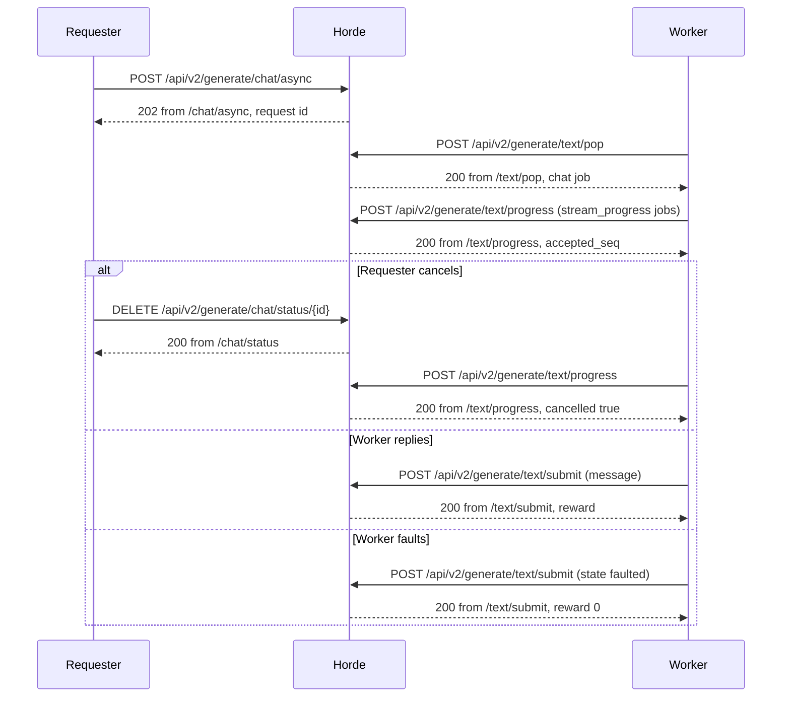

<!--
SPDX-FileCopyrightText: 2026 Tazlin

SPDX-License-Identifier: AGPL-3.0-or-later
-->

# Chat wire examples

<!-- BEGIN GENERATED: topics (gen_doc_index.py) -->
Topics: [chat](../topics.md#chat), [requests](../topics.md#requests), [workers](../topics.md#workers)
<!-- END GENERATED: topics -->

This page holds full JSON bodies for the three chat parties: a requester on the native routes, a client of the
OpenAI-compatible front, and a text worker serving chat jobs. The native fields and rules are specified in the
[chat requests reference](chat_requests.md), the front's in the [chat front reference](chat_front.md); each example
links to the section that specifies it. Ids, keys and kudos values are placeholders such as `"<job-id>"`; limits and
token counts are realistic values. Every example is checked against the running code. A response body has the keys
the server sends; its `rc`, `code`, `type`, `object`, `state`, `finish_reason`, `kind` and `reason` strings and its
booleans are the live values, and every other value that is not a placeholder has the live value's JSON type. Each
request body shown is posted and gets the status shown, and each worker request holds only keys its route reads.
`tests/integration/test_chat_wire_examples.py` checks the native requester and worker examples, and
`tests/integration/test_chat_front_wire_examples.py` checks the front's examples against a front running over the
in-process horde.

One chat job across the native routes, with the worker's three ways of ending it:



## Code map

| Body                    | File                               | Symbol                                                    |
| ----------------------- | ---------------------------------- | --------------------------------------------------------- |
| Native request          | `horde/apis/v2/kobold.py`, `horde/classes/kobold/chat_request.py` | `ChatAsyncGenerate`, `parse_chat_request` |
| Native status           | `horde/apis/v2/kobold.py`          | `ChatAsyncStatus`                                         |
| Chat model list entry   | `horde/apis/v2/base.py`            | `Models.add_chat_offers`                                  |
| Front request           | `horde/oai/schema.py`              | `ChatCompletionRequest`                                   |
| Front completion        | `horde/oai/mapping.py`             | `build_completion`                                        |
| Front stream chunks     | `horde/oai/sse.py`                 | `build_completion_events`                                 |
| Front errors            | `horde/oai/app.py`                 | `ChatFrontError`, `_wait_error`, `_kudos_cap_error`       |
| Front model card        | `horde/oai/mapping.py`             | `build_model_card`                                        |
| Pop request             | `horde/apis/v2/kobold.py`          | `TextJobPop`, `TextJobPop.validate_chat_declaration`      |
| Chat job payload        | `horde/classes/kobold/waiting_prompt.py` | `TextWaitingPrompt.get_pop_payload`                 |
| Submit                  | `horde/apis/v2/kobold.py`          | `TextJobSubmit.prepare_chat_submission`                   |
| Progress post           | `horde/apis/v2/kobold.py`          | `TextJobProgress`                                         |
| Worker details          | `horde/classes/kobold/worker.py`   | `TextWorker.get_chat_details`                             |
| Example bodies in tests | `tests/integration/_fake_chat_worker.py` | `build_pop_body`, `build_chat_submit_body`, `build_faulted_chat_submit_body` |

## Native requester

A requester queues a chat request on `POST /api/v2/generate/chat/async`, polls or cancels it on
`/api/v2/generate/chat/status/{id}`, and finds the models it can ask for on
`GET /api/v2/status/models?type=text&chat=true`. The routes are listed in [Routes](chat_requests.md#routes).

### Request

`POST /api/v2/generate/chat/async` with OpenAI's chat keys and the `horde` options object. The keys and options are
specified in [Request body](chat_requests.md#request-body).

<!-- wire-example: chat-request -->
```json
{
  "model": "<model-name>",
  "messages": [
    {"role": "system", "content": "You are a terse assistant."},
    {"role": "user", "content": [{"type": "text", "text": "Name one colour."}]}
  ],
  "temperature": 0.5,
  "stop": "\nuser:",
  "max_tokens": 64,
  "horde": {
    "max_context_length": 4096,
    "context_fit": "truncate_oldest",
    "conformance": "strict",
    "slow_workers": true,
    "max_kudos": 1000
  }
}
```

### Request accepted

A queued request is answered `202` with its id, which the status route takes
([Routes](chat_requests.md#routes)).

<!-- wire-example: chat-request-accepted -->
```json
{"id": "<request-id>", "kudos": "<kudos>"}
```

### Dry run

A request with `horde.dry_run` is answered `200` with its quote in `kudos` and is not queued. `resolved` holds the
request as the horde sized it ([Context adjustments](chat_requests.md#context-adjustments)).

<!-- wire-example: chat-dry-run -->
```json
{
  "resolved": {
    "estimated_prompt_tokens": 19,
    "context_fit": "grow",
    "prompt": "system: You are a terse assistant.\nuser: Name one colour.",
    "params": {"max_length": 64},
    "models": ["<model-name>"],
    "style": null
  },
  "kudos": "<kudos>"
}
```

### Status while waiting

`GET /api/v2/generate/chat/status/{id}` answers `200`; here the request waits for its one eligible worker. The fields
are those of the text status route ([Routes](chat_requests.md#routes)).

<!-- wire-example: chat-status-waiting -->
```json
{
  "generations": [],
  "context_adjustments": null,
  "impossible_reason": null,
  "fault_reason": null,
  "fault_rc": null,
  "finished": 0,
  "processing": 0,
  "restarted": 0,
  "waiting": 1,
  "done": false,
  "faulted": false,
  "wait_time": 6,
  "queue_position": 1,
  "kudos": "<kudos>",
  "is_possible": true,
  "eligible_workers": 1,
  "eligible_worker_threads": 1,
  "might_stall": false
}
```

### Status when done

The status of a served request answers `200` with the generation's structured reply, the token counts its worker
reported and the `charge_basis` the horde priced it by. The generation fields are listed in
[Pricing](chat_requests.md#pricing).

<!-- wire-example: chat-status-done -->
```json
{
  "generations": [
    {
      "message": {"role": "assistant", "content": "Blue."},
      "finish_reason": "stop",
      "native_finish_reason": "eos_token",
      "prompt_tokens": 21,
      "completion_tokens": 3,
      "reasoning_tokens": null,
      "charge_basis": "output_estimate",
      "queue_wait_seconds": 0.06,
      "text": "Blue.",
      "seed": 0,
      "gen_metadata": [],
      "worker_id": "<worker-id>",
      "worker_name": "<worker-name>",
      "model": "<model-name>",
      "state": "ok"
    }
  ],
  "context_adjustments": null,
  "impossible_reason": null,
  "fault_reason": null,
  "fault_rc": null,
  "finished": 1,
  "processing": 0,
  "restarted": 0,
  "waiting": 0,
  "done": true,
  "faulted": false,
  "wait_time": 0,
  "queue_position": 0,
  "kudos": "<kudos>",
  "is_possible": true,
  "eligible_workers": 1,
  "eligible_worker_threads": 1,
  "might_stall": false
}
```

### Status with context adjustments

The `200` status of a long history sent with `max_context_length` 2048 under the default `truncate_oldest`: the
context grew to the largest chat context an online worker declares, and the oldest turns were dropped to fit it. The
entries are specified in [Context adjustments](chat_requests.md#context-adjustments).

<!-- wire-example: chat-status-context-adjustments -->
```json
{
  "generations": [],
  "context_adjustments": [
    {"from": 2048, "to": 8192, "reason": "grow"},
    {"from": 19853, "to": 7459, "reason": "truncate_oldest", "dropped_messages": 10}
  ],
  "impossible_reason": null,
  "fault_reason": null,
  "fault_rc": null,
  "finished": 0,
  "processing": 0,
  "restarted": 0,
  "waiting": 1,
  "done": false,
  "faulted": false,
  "wait_time": 6,
  "queue_position": 1,
  "kudos": "<kudos>",
  "is_possible": true,
  "eligible_workers": 1,
  "eligible_worker_threads": 1,
  "might_stall": false
}
```

### NoEligibleWorker

An anonymous request with an image and `max_tokens` 1024, above the free output floor, while the only online worker
serving the model does not declare `vision`, is answered `403`. The refusal is specified in
[Free output allowance](chat_requests.md#free-output-allowance) and `impossible_reason` in
[Impossible reason](chat_requests.md#impossible-reason).

<!-- wire-example: refusal-no-eligible-worker -->
```json
<!-- --8<-- [start:refusal-no-eligible-worker] -->
{
  "message": "No online worker can serve this request: no online worker serving the model declares vision.",
  "rc": "NoEligibleWorker",
  "impossible_reason": {"kind": "declaration_gap", "missing_declarations": ["vision"], "exceeded_limits": []}
}
<!-- --8<-- [end:refusal-no-eligible-worker] -->
```

### UnsupportedChatParameter

A request carrying `logprobs` is answered `400`, with the key in the message. The keys and values refused this way are
listed in [Refused keys and values](chat_requests.md#refused-keys-and-values).

<!-- wire-example: refusal-unsupported-chat-parameter -->
```json
{
  "message": "'logprobs' is not supported on chat requests.",
  "rc": "UnsupportedChatParameter"
}
```

### Chat model list

`GET /api/v2/status/models?type=text&chat=true` answers `200` with an array holding one entry per model an online chat
worker serves, shown here with one entry. The `chat` object is specified in
[Chat model list](chat_requests.md#chat-model-list).

<!-- wire-example: chat-model-list -->
```json
[
  {
    "chat": {
      "workers": 1,
      "max_context_length": 8192,
      "max_length": 1024,
      "features": ["presence_penalty", "prompt_overflow_refused", "seed", "tool_choice_enforced", "vision"],
      "created": 1793463623
    },
    "performance": 0.0,
    "queued": 0.0,
    "jobs": 0.0,
    "eta": 0,
    "type": "text",
    "name": "<model-name>",
    "count": 1
  }
]
```

## OpenAI-compatible front

A client of the front sends `POST /v1/chat/completions` with a bearer key and lists models on `GET /v1/models`. The
request keys are specified in [Request keys](chat_front.md#request-keys), and their use is in
[Send chat completions through the OpenAI-compatible front](../how-to/send_chat_completions.md).

### Front request

`POST /v1/chat/completions` with OpenAI's keys. The `horde` object of the [native request](#request) is accepted here
as well ([Sampling defaults and the horde object](../how-to/send_chat_completions.md#sampling-defaults-and-the-horde-object)).

<!-- wire-example: front-request -->
```json
{
  "model": "<model-name>",
  "messages": [
    {"role": "system", "content": "You are a terse assistant."},
    {"role": "user", "content": "Name one colour."}
  ],
  "max_tokens": 64,
  "temperature": 0.5
}
```

### Completion

The front answers `200` with the completion once the worker's reply arrives. `x_horde` carries the native request id,
the worker and the charge. The fields are specified in [Response shape](chat_front.md#response-shape).

<!-- wire-example: front-response -->
```json
{
  "id": "chatcmpl-<request-id>",
  "object": "chat.completion",
  "created": 1793463887,
  "model": "<model-name>",
  "choices": [
    {
      "index": 0,
      "message": {"role": "assistant", "content": "Blue."},
      "finish_reason": "stop",
      "native_finish_reason": null,
      "logprobs": null
    }
  ],
  "usage": {"prompt_tokens": 21, "completion_tokens": 3, "total_tokens": 24},
  "system_fingerprint": "fp_704a460ec9",
  "x_horde": {
    "request_id": "<request-id>",
    "worker_id": "<worker-id>",
    "worker_name": "<worker-name>",
    "kudos": "<kudos>",
    "charge_basis": "output_estimate",
    "estimated_usage": false,
    "queue_wait_seconds": 0.28
  }
}
```

### Content chunk

The same request with `stream: true` and `stream_options.include_usage` is answered `200` with a stream of
`chat.completion.chunk` events. After the role chunk, this chunk carries the reply's text. The order of the chunks is
in [Response shape](chat_front.md#response-shape).

<!-- wire-example: front-stream-content-chunk -->
```json
{
  "id": "chatcmpl-<request-id>",
  "object": "chat.completion.chunk",
  "created": 1793463889,
  "model": "<model-name>",
  "choices": [
    {
      "index": 0,
      "delta": {"content": "Blue."},
      "finish_reason": null,
      "native_finish_reason": null,
      "logprobs": null
    }
  ],
  "usage": null,
  "system_fingerprint": "fp_704a460ec9"
}
```

### Finish chunk

The finish chunk of the same `200` stream has an empty `delta`, the `finish_reason` and `x_horde`.

<!-- wire-example: front-stream-finish-chunk -->
```json
{
  "id": "chatcmpl-<request-id>",
  "object": "chat.completion.chunk",
  "created": 1793463889,
  "model": "<model-name>",
  "choices": [
    {
      "index": 0,
      "delta": {},
      "finish_reason": "stop",
      "native_finish_reason": null,
      "logprobs": null
    }
  ],
  "usage": null,
  "system_fingerprint": "fp_704a460ec9",
  "x_horde": {
    "request_id": "<request-id>",
    "worker_id": "<worker-id>",
    "worker_name": "<worker-name>",
    "kudos": "<kudos>",
    "charge_basis": "output_estimate",
    "estimated_usage": false,
    "queue_wait_seconds": 0.2
  }
}
```

### Usage chunk

The last chunk of the same `200` stream, sent for `stream_options.include_usage`, has empty `choices` and the
`usage`. `data: [DONE]` follows it ([Response shape](chat_front.md#response-shape)).

<!-- wire-example: front-stream-usage-chunk -->
```json
{
  "id": "chatcmpl-<request-id>",
  "object": "chat.completion.chunk",
  "created": 1793463890,
  "model": "<model-name>",
  "choices": [],
  "usage": {"prompt_tokens": 21, "completion_tokens": 3, "total_tokens": 24},
  "system_fingerprint": "fp_704a460ec9"
}
```

### Tool-call completion

A request offering a `get_weather` tool, answered `200` with the worker's call: `content` is null and `finish_reason`
is `tool_calls`. The message shape is specified in [Response shape](chat_front.md#response-shape), and the round
trip is in [Tools and tool_choice](../how-to/send_chat_completions.md#tools-and-tool_choice).

<!-- wire-example: front-tool-call-response -->
```json
{
  "id": "chatcmpl-<request-id>",
  "object": "chat.completion",
  "created": 1793463891,
  "model": "<model-name>",
  "choices": [
    {
      "index": 0,
      "message": {
        "role": "assistant",
        "content": null,
        "tool_calls": [
          {
            "id": "call_weather_1",
            "type": "function",
            "function": {"name": "get_weather", "arguments": "{\"city\":\"Paris\"}"}
          }
        ]
      },
      "finish_reason": "tool_calls",
      "native_finish_reason": null,
      "logprobs": null
    }
  ],
  "usage": {"prompt_tokens": 21, "completion_tokens": 3, "total_tokens": 24},
  "system_fingerprint": "fp_704a460ec9",
  "x_horde": {
    "request_id": "<request-id>",
    "worker_id": "<worker-id>",
    "worker_name": "<worker-name>",
    "kudos": "<kudos>",
    "charge_basis": "output_estimate",
    "estimated_usage": false,
    "queue_wait_seconds": 0.21
  }
}
```

### No worker supports features

A request with `reasoning_effort` while the only online worker serving the model does not declare that feature is
answered `404`, and the front cancels the native request. The answer is specified in
[No eligible worker](chat_front.md#no-eligible-worker).

<!-- wire-example: front-no-worker-supports-features -->
```json
<!-- --8<-- [start:front-no-worker-supports-features] -->
{
  "error": {
    "message": "No worker can serve this request: no online worker serving the model declares reasoning_effort. The request was cancelled.",
    "type": "not_found_error",
    "param": null,
    "code": "no_worker_supports_features",
    "metadata": {"request_id": "<request-id>"}
  }
}
<!-- --8<-- [end:front-no-worker-supports-features] -->
```

### Kudos cap

A request whose kudos estimate is above its `horde.max_kudos` is answered `400`, and the horde does not create it.
The values in `metadata` are read from the native `ChatKudosCapExceeded` message, as specified in
[Kudos cap](chat_front.md#kudos-cap).

<!-- wire-example: front-kudos-cap -->
```json
<!-- --8<-- [start:front-kudos-cap] -->
{
  "error": {
    "message": "The request's kudos estimate at current pricing is 215, above its horde.max_kudos of 1. The estimate assumes the full max_tokens is generated.",
    "type": "invalid_request_error",
    "param": "horde.max_kudos",
    "code": "max_kudos_exceeded",
    "metadata": {"rc": "ChatKudosCapExceeded", "kudos_estimate": 215, "max_kudos": 1}
  }
}
<!-- --8<-- [end:front-kudos-cap] -->
```

### Model list

`GET /v1/models` answers `200` with one model card per text model an online chat worker serves, shown here with one
card. The card's fields are specified in [Model card fields](chat_front.md#model-card-fields) and read as in
[Choose a model from the model card](../how-to/send_chat_completions.md#choose-a-model-from-the-model-card).

<!-- wire-example: front-model-list -->
```json
{
  "object": "list",
  "data": [
    {
      "id": "<model-name>",
      "object": "model",
      "created": 1793463881,
      "owned_by": "aihorde",
      "context_length": 8192,
      "architecture": {
        "modality": "text+image->text",
        "input_modalities": ["text", "image"],
        "output_modalities": ["text"]
      },
      "top_provider": {"context_length": 8192, "max_completion_tokens": 1024},
      "supported_parameters": [
        "max_tokens",
        "temperature",
        "top_p",
        "stop",
        "seed",
        "presence_penalty",
        "tools",
        "parallel_tool_calls",
        "tool_choice",
        "response_format"
      ],
      "x_horde": {"workers": 1, "queued": 0.0}
    }
  ]
}
```

## Worker

A text worker pops chat jobs on `/api/v2/generate/text/pop`, posts progress on `/api/v2/generate/text/progress` and
submits on `/api/v2/generate/text/submit`. The procedure is
[Serve chat jobs from a text worker](../how-to/serve_chat_jobs.md).

### Pop

#### Pop request

`POST /api/v2/generate/text/pop` with the chat declaration beside the text fields. `chat_features` carries three
features and two guarantees in one list. The chat fields are specified in
[Chat declaration on pop](chat_requests.md#chat-declaration-on-pop) and explained in
[Declare chat on pop](../how-to/serve_chat_jobs.md#1-declare-chat-on-pop).

<!-- wire-example: pop-request -->
```json
<!-- --8<-- [start:pop-request] -->
{
  "name": "<worker-name>",
  "models": ["<model-name>"],
  "bridge_agent": "<bridge-agent>",
  "amount": 1,
  "max_context_length": 4096,
  "max_length": 512,
  "chat_jobs": true,
  "chat_features": [
    "seed",
    "presence_penalty",
    "vision",
    "tool_choice_enforced",
    "prompt_overflow_refused"
  ],
  "chat_limits": {"max_context_length": 8192, "max_length": 1024},
  "model_id": "<model-name>",
  "image_transports": ["url", "base64"]
}
<!-- --8<-- [end:pop-request] -->
```

#### Chat job

The pop answers `200` with `chat: true` and the conversation in `payload.messages`; the top-level `messages` holds
horde messages for the worker's owner. The payload is specified in
[Chat job pop response](chat_requests.md#chat-job-pop-response).

<!-- wire-example: pop-chat-job -->
```json
<!-- --8<-- [start:pop-chat-job] -->
{
  "payload": {
    "messages": [
      {"role": "system", "content": "You are a terse assistant."},
      {"role": "user", "content": [{"type": "text", "text": "Name one colour."}]}
    ],
    "temperature": 0.5,
    "top_p": 1.0,
    "frequency_penalty": 0.0,
    "presence_penalty": 0.0,
    "rep_pen": 1.0,
    "top_k": 0,
    "min_p": 0.0,
    "stop_sequence": ["\nuser:"],
    "max_length": 512,
    "max_context_length": 2048,
    "n": 1
  },
  "id": "<job-id>",
  "ids": ["<job-id>"],
  "messages": [],
  "ttl": 150,
  "extra_source_images": null,
  "skipped": {},
  "softprompt": null,
  "model": "<model-name>",
  "chat": true
}
<!-- --8<-- [end:pop-chat-job] -->
```

#### Chat job with tools

A `200` pop of a request that offers a tool, with a history in which the model already called it once and the client
answered. The tool keys are specified in [Tools](chat_requests.md#tools) and served as in
[Serve tools and structured output](../how-to/serve_chat_jobs.md#4-serve-tools-and-structured-output).

<!-- wire-example: pop-chat-job-tools -->
```json
{
  "payload": {
    "messages": [
      {"role": "user", "content": "Weather in Oslo, then Bergen?"},
      {
        "role": "assistant",
        "content": null,
        "tool_calls": [
          {
            "id": "call_oslo",
            "type": "function",
            "function": {"name": "lookup_weather", "arguments": "{\"city\":\"Oslo\"}"}
          }
        ]
      },
      {"role": "tool", "content": "Rain, 7C", "tool_call_id": "call_oslo"}
    ],
    "tools": [
      {
        "type": "function",
        "function": {
          "name": "lookup_weather",
          "description": "Look up the weather.",
          "parameters": {"type": "object", "properties": {"city": {"type": "string"}}}
        }
      }
    ],
    "tool_choice": "auto",
    "parallel_tool_calls": false,
    "response_format": {"type": "json_object"},
    "temperature": 0.5,
    "top_p": 1.0,
    "frequency_penalty": 0.0,
    "presence_penalty": 0.0,
    "rep_pen": 1.0,
    "top_k": 0,
    "min_p": 0.0,
    "stop_sequence": ["\nuser:"],
    "max_length": 512,
    "max_context_length": 2048,
    "n": 1
  },
  "id": "<job-id>",
  "ids": ["<job-id>"],
  "messages": [],
  "ttl": 150,
  "extra_source_images": null,
  "skipped": {},
  "softprompt": null,
  "model": "<model-name>",
  "chat": true
}
```

#### Chat job with an image

A `200` pop for a worker that declares `vision` and only the `base64` transport, so the image part arrives as an
inline JPEG data URL. Image parts are specified in [Images](chat_requests.md#images) and served as in
[Serve images](../how-to/serve_chat_jobs.md#5-serve-images).

<!-- wire-example: pop-chat-job-image -->
```json
{
  "payload": {
    "messages": [
      {"role": "system", "content": "Describe images briefly."},
      {
        "role": "user",
        "content": [
          {"type": "text", "text": "What is in these?"},
          {"type": "image_url", "image_url": {"url": "data:image/jpeg;base64,<base64-jpeg>"}}
        ]
      }
    ],
    "temperature": 1.0,
    "top_p": 1.0,
    "frequency_penalty": 0.0,
    "presence_penalty": 0.0,
    "rep_pen": 1.0,
    "top_k": 0,
    "min_p": 0.0,
    "max_length": 64,
    "max_context_length": 2048,
    "n": 1
  },
  "id": "<job-id>",
  "ids": ["<job-id>"],
  "messages": [],
  "ttl": 150,
  "extra_source_images": null,
  "skipped": {},
  "softprompt": null,
  "model": "<model-name>",
  "chat": true
}
```

#### Chat job with offloaded messages

A `200` pop of an offloaded request for a worker that declares `messages_url`: the payload carries `messages_url` and
no `messages`. The URL and its body are specified in [Messages offload](chat_requests.md#messages-offload) and
fetched as in [Fetch offloaded messages](../how-to/serve_chat_jobs.md#fetch-offloaded-messages).

<!-- wire-example: pop-chat-job-messages-url -->
```json
{
  "payload": {
    "messages_url": "<signed-url>",
    "temperature": 1.0,
    "top_p": 1.0,
    "frequency_penalty": 0.0,
    "presence_penalty": 0.0,
    "rep_pen": 1.0,
    "top_k": 0,
    "min_p": 0.0,
    "max_length": 64,
    "max_context_length": 2048,
    "n": 1
  },
  "id": "<job-id>",
  "ids": ["<job-id>"],
  "messages": [],
  "ttl": 150,
  "extra_source_images": null,
  "skipped": {},
  "softprompt": null,
  "model": "<model-name>",
  "chat": true
}
```

#### No job

A pop with no job for the worker answers `200` with `id` null, an empty `ids` and no `chat` key. The pop loop around
it is in [Recognise a chat job](../how-to/serve_chat_jobs.md#2-recognise-a-chat-job).

<!-- wire-example: pop-no-job -->
```json
{
  "payload": {
    "max_context_length": 2048,
    "max_length": 80,
    "min_p": 0.0,
    "smoothing_factor": 0.0,
    "dynatemp_range": 0.0,
    "dynatemp_exponent": 1.0
  },
  "id": null,
  "ids": [],
  "messages": [],
  "ttl": null,
  "extra_source_images": null,
  "skipped": {},
  "softprompt": null,
  "model": null
}
```

### Submit

#### Reply

`POST /api/v2/generate/text/submit` with a structured reply and the counts the backend reported. The fields are
specified in [Structured submit](chat_requests.md#structured-submit) and built as in
[Submit the reply](../how-to/serve_chat_jobs.md#6-submit-the-reply).

<!-- wire-example: submit-reply -->
```json
<!-- --8<-- [start:submit-reply] -->
{
  "id": "<job-id>",
  "message": {"role": "assistant", "content": "Blue."},
  "finish_reason": "stop",
  "model_id": "<model-name>",
  "state": "ok",
  "prompt_tokens": 21,
  "completion_tokens": 3,
  "native_finish_reason": "eos_token"
}
<!-- --8<-- [end:submit-reply] -->
```

#### Tool-call reply

A reply that only calls a tool, so `content` is null and `finish_reason` is `tool_calls`, submitted for the job in
[Chat job with tools](#chat-job-with-tools). The call's shape is specified in
[Structured submit](chat_requests.md#structured-submit).

<!-- wire-example: submit-tool-calls -->
```json
{
  "id": "<job-id>",
  "message": {
    "role": "assistant",
    "content": null,
    "tool_calls": [
      {
        "id": "call_bergen",
        "type": "function",
        "function": {"name": "lookup_weather", "arguments": "{\"city\":\"Bergen\"}"}
      }
    ]
  },
  "finish_reason": "tool_calls",
  "model_id": "<model-name>",
  "state": "ok"
}
```

#### Reply with reasoning

A reply whose model reasoned before answering, with the reasoning in `message.reasoning_content` and its token count
in `reasoning_tokens`. Both are specified in [Reasoning](chat_requests.md#reasoning).

<!-- wire-example: submit-reasoning -->
```json
{
  "id": "<job-id>",
  "message": {
    "role": "assistant",
    "content": "Blue.",
    "reasoning_content": "The user asks for one colour."
  },
  "finish_reason": "stop",
  "model_id": "<model-name>",
  "state": "ok",
  "prompt_tokens": 21,
  "completion_tokens": 40,
  "reasoning_tokens": 37
}
```

#### Reply response

Each of the three replies above is answered `200` with the kudos the worker earned. The reward is priced as in
[Pricing](chat_requests.md#pricing).

<!-- wire-example: submit-reply-response -->
```json
<!-- --8<-- [start:submit-reply-response] -->
{"reward": "<kudos>"}
<!-- --8<-- [end:submit-reply-response] -->
```

#### Fault

A job the worker cannot serve is submitted with `state` `faulted`, neither `generation` nor `message`, and here a
`fault_reason`. The values are listed in [Worker fault reasons](chat_requests.md#worker-fault-reasons) and their use in
[Fault a job](../how-to/serve_chat_jobs.md#7-fault-a-job).

<!-- wire-example: submit-fault -->
```json
{
  "id": "<job-id>",
  "state": "faulted",
  "model_id": "<model-name>",
  "fault_reason": "prompt_overflow"
}
```

#### Fault response

A fault is answered `200` with a reward of 0, and the job returns to the queue for another worker
([Fault a job](../how-to/serve_chat_jobs.md#7-fault-a-job)).

<!-- wire-example: submit-fault-response -->
```json
{"reward": 0}
```

### Progress

#### Progress post

`POST /api/v2/generate/text/progress`, sent with the worker owner's `apikey` header, for a job whose payload carries
`stream_progress: true`. The fields are specified in [Streaming progress](chat_requests.md#streaming-progress) and
the posting loop is in [Streaming progress](../how-to/serve_chat_jobs.md#streaming-progress).

<!-- wire-example: progress-post -->
```json
{"id": "<job-id>", "seq": 1, "delta": {"content": "Blue"}}
```

#### Progress accepted

An accepted post is answered `200` with its `seq` and `cancelled` false.

<!-- wire-example: progress-accepted -->
```json
{"accepted_seq": 1, "cancelled": false}
```

#### Progress after a cancel

The first post after the requester cancelled is answered `200` with `cancelled` true. The worker's response to it is
in [Streaming progress](../how-to/serve_chat_jobs.md#streaming-progress).

<!-- wire-example: progress-cancelled -->
```json
{"accepted_seq": 2, "cancelled": true}
```

#### Progress out of sequence

A post whose `seq` skips one is answered `409` with the `seq` the horde expects next. The other refusals of the route
are listed in [Streaming progress](chat_requests.md#streaming-progress).

<!-- wire-example: progress-out-of-sequence -->
```json
{
  "message": "Expected seq 2 for generation <job-id>.",
  "rc": "ChatProgressOutOfSequence",
  "expected_seq": 2
}
```

### Refusals

Every refusal has a `message` for people and an `rc` for code. The conditions for each return code are in
[Declare chat on pop](../how-to/serve_chat_jobs.md#1-declare-chat-on-pop) and
[Submit the reply](../how-to/serve_chat_jobs.md#6-submit-the-reply).

#### ChatDeclarationInvalid

A pop whose `model_id` is not one of its `models` is answered `400`, and the pop does not assign a job.

<!-- wire-example: refusal-chat-declaration-invalid -->
```json
{
  "message": "model_id 'koboldcpp/model_Q4' has to be one of the worker's models.",
  "rc": "ChatDeclarationInvalid"
}
```

#### ChatSubmitInvalid

A chat submit without `finish_reason` is answered `400`. The other malformed submits get the same return code with
their own message.

<!-- wire-example: refusal-chat-submit-invalid -->
```json
{
  "message": "A chat job's submission needs 'finish_reason'.",
  "rc": "ChatSubmitInvalid"
}
```

#### ChatSubmitNonconformant

A text reply to a strict request with `tool_choice: "required"` is answered `400`. The checks are specified in
[Reply verification](chat_requests.md#reply-verification).

<!-- wire-example: refusal-chat-submit-nonconformant -->
```json
{
  "message": "The request's 'tool_choice' is 'required', so the reply needs 'tool_calls'.",
  "rc": "ChatSubmitNonconformant"
}
```

#### ChatModelMismatch

A submit whose `model_id` differs from the model the job was assigned is answered `400`.

<!-- wire-example: refusal-chat-model-mismatch -->
```json
{
  "message": "'model_id' has to be '<model-name>', the model this job was assigned.",
  "rc": "ChatModelMismatch"
}
```

### Worker details

`GET /api/v2/workers/name/<worker-name>` without an API key answers `200` with the public details of a worker whose
last pop declared chat jobs with a tool temperature limit. `accepts_chat_jobs`,
`accepts_prompt_jobs` and `chat` are specified in [Worker details](chat_requests.md#worker-details).

<!-- wire-example: worker-details -->
```json
{
  "requests_fulfilled": 120,
  "kudos_rewards": "<kudos>",
  "kudos_details": {"generated": "<kudos>", "uptime": "<kudos>"},
  "performance": "14.2 tokens per second",
  "threads": 1,
  "uptime": 86400,
  "maintenance_mode": false,
  "nsfw": true,
  "trusted": true,
  "flagged": false,
  "uncompleted_jobs": 0,
  "nonconformant_replies": 0,
  "models": ["<model-name>"],
  "team": {"name": null, "id": null},
  "bridge_agent": "<bridge-agent>",
  "accepts_chat_jobs": true,
  "accepts_prompt_jobs": true,
  "chat": {
    "model_id": "<model-name>",
    "features": [
      "presence_penalty",
      "prompt_overflow_refused",
      "seed",
      "tool_choice_enforced",
      "vision"
    ],
    "limits": {"max_context_length": 8192, "max_length": 1024, "tools_max_temperature": 0.7},
    "image_transports": ["base64", "url"]
  },
  "max_length": 512,
  "max_context_length": 4096,
  "type": "text",
  "name": "<worker-name>",
  "id": "<worker-id>",
  "online": true
}
```

## Related

- [Chat requests reference](chat_requests.md): every native field and refusal shown on this page.
- [Chat front reference](chat_front.md): the front's request keys, response and stream shapes, errors and model cards.
- [Send chat completions through the OpenAI-compatible front](../how-to/send_chat_completions.md): the client side of
  the front's bodies.
- [Serve chat jobs from a text worker](../how-to/serve_chat_jobs.md): the pop loop the worker bodies travel through.
- [Serve your first chat job with koboldcpp](../tutorial/first_chat_worker.md): a first end-to-end run with a real backend.
